# Лабораторная работа №2. Облачные вычислительные сервисы. Amazon EC2

- **Студент:** Semion Dubrovschii
- **Группа:** I2402
- **Специальность:** Informatică
- **Уровень:** продвинутый
- **Приложение:** TimeCapsule, `open_capsules_php_functional`
- **Вариант деплоя:** B, скрипт `deploy.sh`
- **Репозиторий:** https://github.com/usm-cloud/timecapsule
- **Регион:** `eu-central-1` (Frankfurt), экземпляр `webserver`, ID i-09be0c7380fb4e2c9

Описание самого приложения TimeCapsule лежит в [APP_README.md](APP_README.md).

## 1. Базовый уровень

### Задание 1. Бюджет

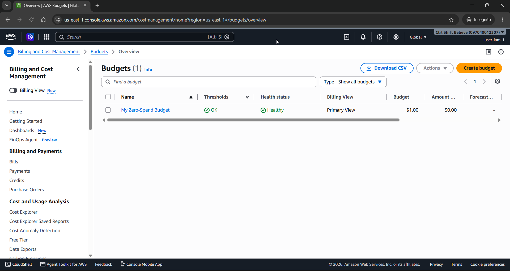
Бюджет `ZeroSpend` в списке `Budgets`.

### Задание 2. Запуск экземпляра

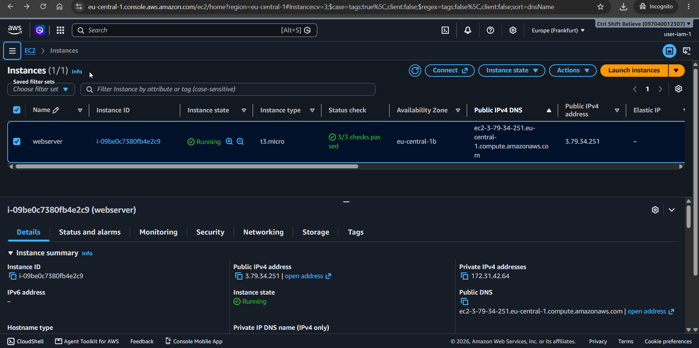
Экземпляр `webserver` в состоянии `Running`, все проверки пройдены.

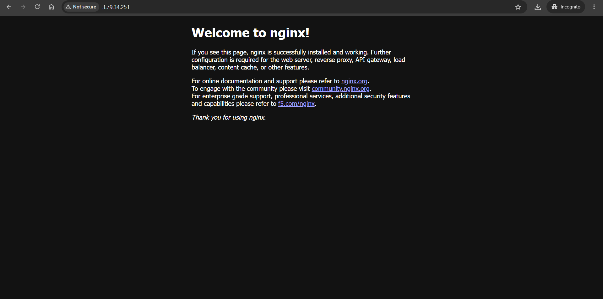
Приветственная страница nginx по публичному IP.

### Задание 3. Мониторинг и диагностика

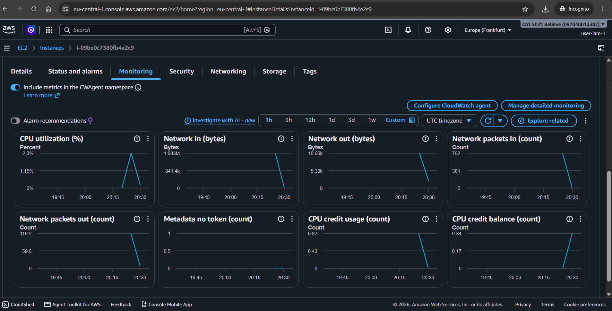
Вкладка `Monitoring` с метриками CloudWatch.

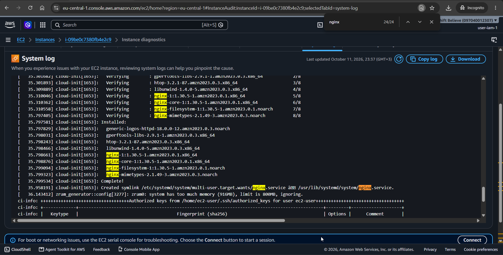
Фрагмент `System log`, где скрипт User data ставит nginx.

### Задание 4. SSH

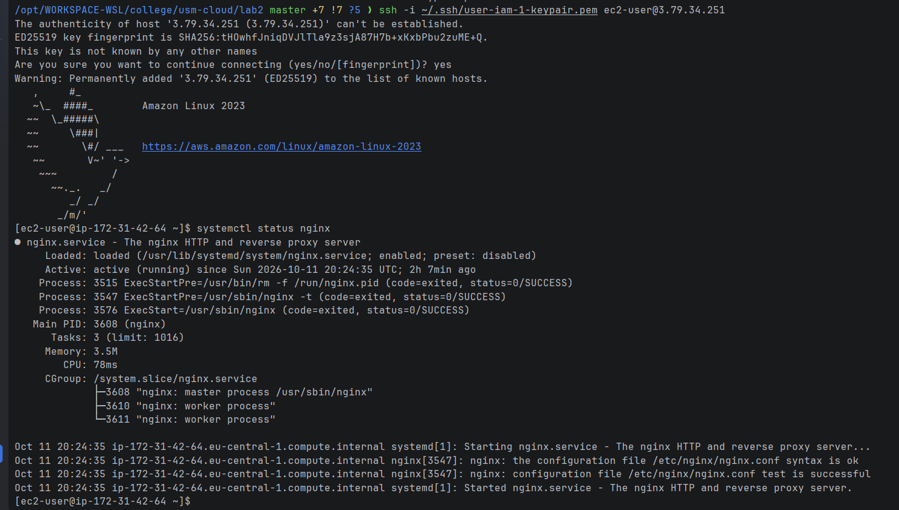
Подключение по SSH и `systemctl status nginx` в состоянии `active (running)`.

### Задание 5. Статический сайт

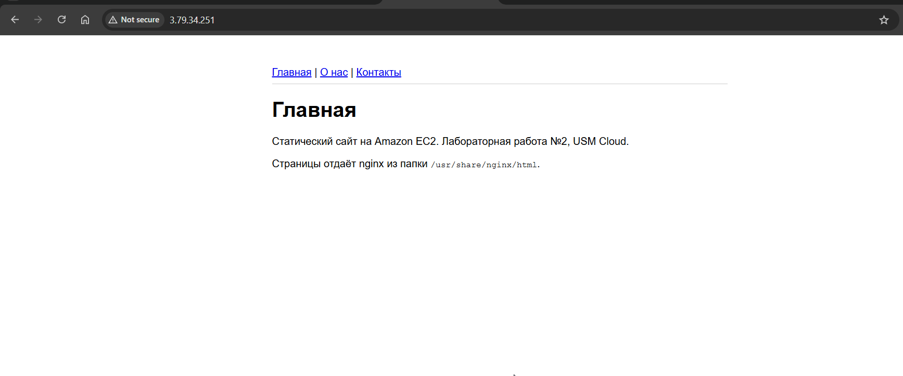
Мой сайт из трёх страниц по публичному IP.

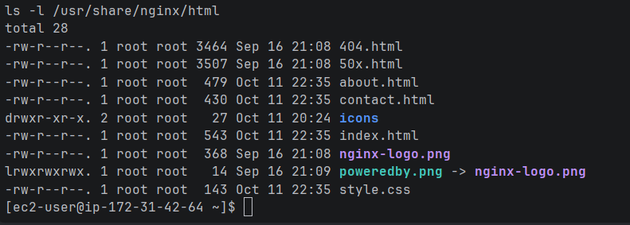
Вывод `ls -l /usr/share/nginx/html`.

### Задание 6. Остановка через AWS CLI

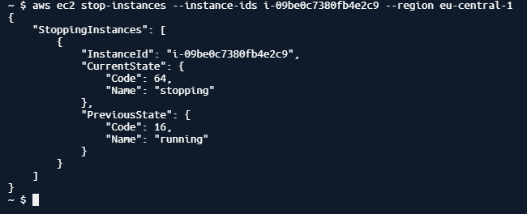
Команда `aws ec2 stop-instances` и её вывод: состояние `running` → `stopping`.

## 2. Продвинутый уровень

### Задание 9. PostgreSQL

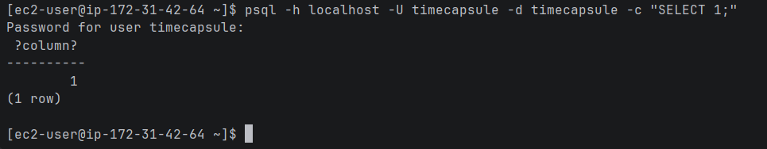
Подключение пользователем `timecapsule` по паролю, ответ `SELECT 1`.

### Задание 10. Код на сервере

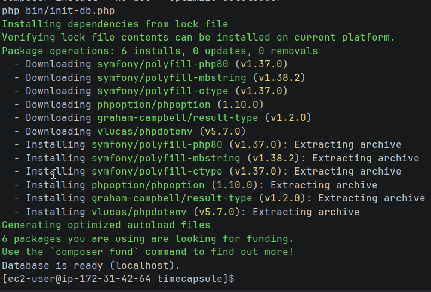
Вывод `php bin/init-db.php`: `Database is ready`.

### Задание 11. PHP-FPM и nginx

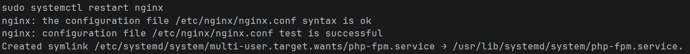
Вывод `sudo nginx -t`: конфигурация без ошибок.

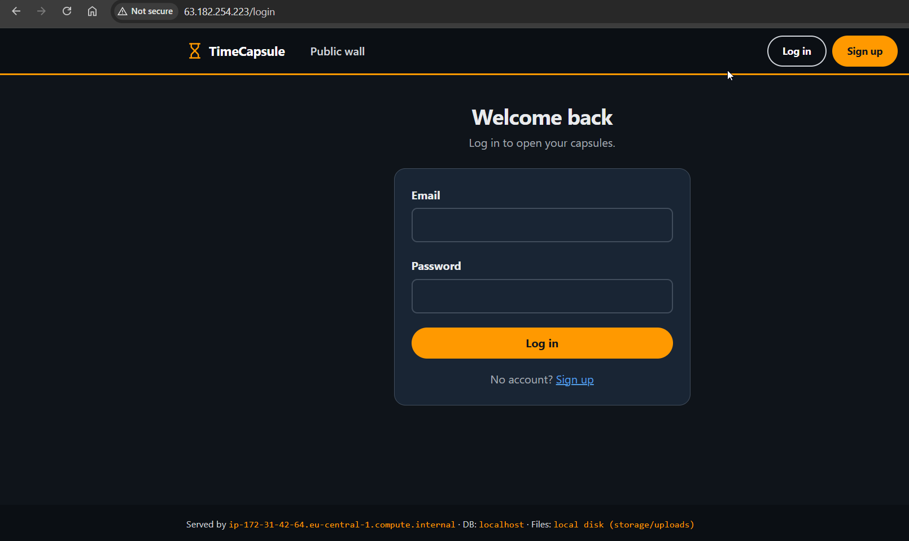
Страница входа TimeCapsule в браузере.

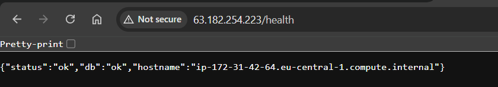
Ответ `/health`: `{"status":"ok","db":"ok",...}`.

### Задание 12. Деплой скриптом

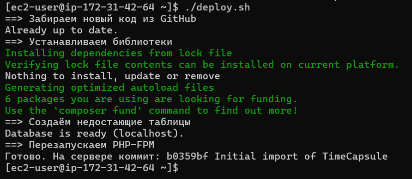
`deploy.sh`, запущенный с моего компьютера командой `ssh ... ./deploy.sh`.

### Задание 13. Новая версия, поломка и откат

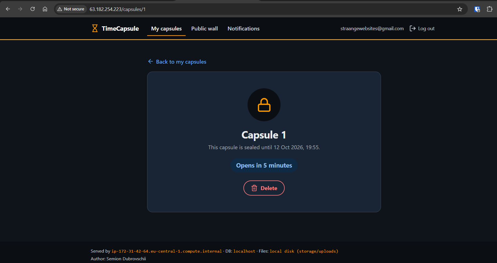
Новая версия: в подвале страницы моё имя.

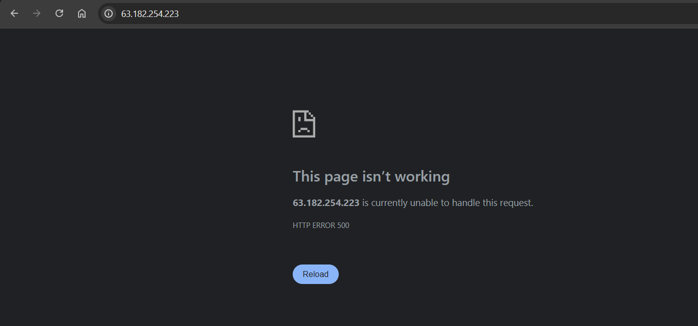
Ошибка 500 после деплоя сломанного `views/layout.php`.

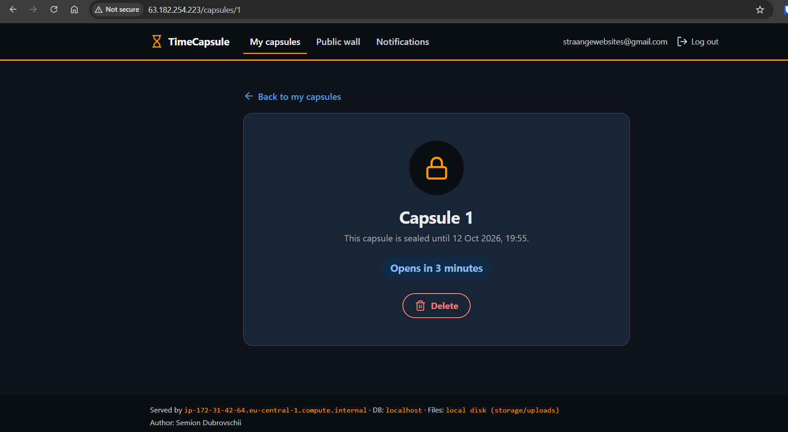
Сайт снова работает после `git revert` и повторного деплоя.

## 3. Архитектура

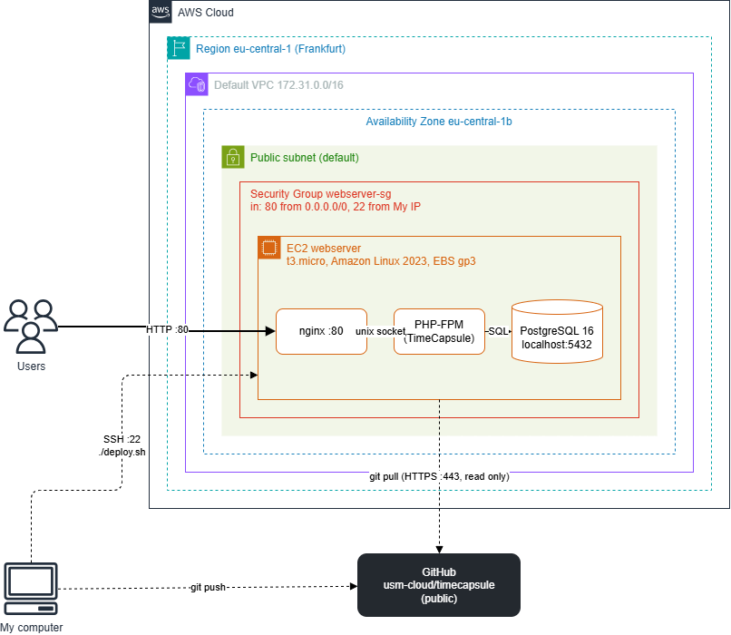

Пользователи открывают сайт по HTTP (порт 80).
Запрос проходит Security Group `webserver-sg` и попадает на nginx на экземпляре EC2.
nginx отдаёт статику сам, а PHP передаёт в PHP-FPM через unix-сокет. PHP-FPM ходит в PostgreSQL на `localhost:5432`.
С моего компьютера код уходит в GitHub через `git push`, а деплой запускается по SSH (порт 22).
Сервер сам забирает код из GitHub по HTTPS.

Решение о способе деплоя: [docs/adr/0001-deploy-method.md](docs/adr/0001-deploy-method.md).

## 4. Ответы на вопросы из заданий

**Задание 1. Что разрешает `AdministratorAccess`? Почему нельзя работать под root?**
Политика разрешает любые действия со всеми сервисами и ресурсами AWS (`"Action": "*"`, `"Resource": "*"`).
Root может ещё больше: закрыть аккаунт, менять оплату и план поддержки. Его права нельзя ограничить политикой.
Если украдут данные root, аккаунт потерян целиком. Поэтому root нужен только для редких задач, а работаем под IAM-пользователем, которого можно ограничить или отключить.

**Задание 2. Что такое User data и когда выполняется скрипт?**
User data это скрипт или данные, которые экземпляр получает при запуске. cloud-init выполняет скрипт от имени root.
По умолчанию он выполняется один раз, при первом запуске экземпляра.
После перезагрузки или Stop/Start он повторно не выполняется.

**Задание 3. Какая проверка показывает мою проблему, а какая проблему AWS?**
*System status check* показывает проблему на стороне AWS: железо, сеть, питание. Её обычно лечат Stop/Start, тогда экземпляр переезжает на другой сервер.
*Instance status check* показывает проблему внутри машины: ОС не загрузилась, сломана настройка сети, кончилась память или диск. Это исправляю я.
*Attached EBS status check* показывает, что том EBS недоступен. Чаще всего это проблема AWS.

**Задание 3. Когда включать детальный мониторинг?**
Когда важна быстрая реакция: продакшен, автомасштабирование (Auto Scaling), тревоги (alarms) по CPU.
Раз в 5 минут можно не увидеть короткий скачок нагрузки, а раз в минуту он виден.
Для учебного сервера хватает базового бесплатного мониторинга.

**Задание 4. Почему ключ, а не пароль?**
Приватный ключ длинный и случайный, подобрать его перебором нельзя, а пароль можно.
Приватный ключ не передаётся по сети. Сервер хранит только публичный ключ, и его кража ничего не даёт.
Поэтому в Amazon Linux вход по паролю для SSH выключен.

**Задание 5. Что делает `scp` и чем похожа на `ssh`?**
`scp` копирует файлы между компьютерами по протоколу SSH.
Она использует тот же ключ (`-i`), того же пользователя и тот же порт 22, и трафик так же шифруется.
Разница в том, что `ssh` даёт терминал на сервере, а `scp` только передаёт файлы.

**Задание 6. Чем Stop отличается от Terminate? За что я плачу, пока экземпляр остановлен?**
Stop выключает машину, но диск EBS и все настройки остаются. Её можно запустить снова (публичный IP изменится).
Terminate удаляет экземпляр навсегда, и корневой том EBS по умолчанию удаляется вместе с ним.
Пока экземпляр остановлен, за вычисления не платим. Платим за тома EBS и их снимки, а также за Elastic IP, если он есть.

**Задание 7. Почему `vendor/` и `.env` не попали в репозиторий?**
Они перечислены в `.gitignore`.
`vendor/` создаётся командой `composer install` из `composer.lock`, хранить его в git не нужно.
В `.env` лежат пароли и настройки конкретного сервера, публиковать их нельзя.

**Задание 8. Почему пакеты ставим вручную, а не через User data?**
User data выполняется только при первом запуске, а экземпляр уже создан в Части 1.
Чтобы скрипт выполнился снова, пришлось бы создать новый экземпляр.
Кроме того, вручную мы видим вывод каждой команды и сразу замечаем ошибки.

**Задание 10. Почему пароль в `.env`, а не в коде? Почему публичный репозиторий безопасен?**
Код один для всех, а пароль у каждого сервера свой. Пароль в публичном репозитории увидит любой, и он останется в истории git даже после удаления.
Репозиторий безопасен, потому что в нём нет секретов: только код, а `.env` в `.gitignore`.
К тому же база слушает только `localhost`, и из интернета к ней не подключиться.

**Задание 12. Что увидит посетитель во время `git pull`? Что будет без `composer install`?**
Во время `git pull` часть файлов уже новая, а часть ещё старая. Посетитель может получить ошибку 500 или страницу, собранную из разных версий.
Если новая версия использует новую библиотеку, а `composer install` не выполнен, этой библиотеки нет в `vendor/`. Тогда PHP выдаст ошибку, и сайт перестанет работать.

**Задание 13. Почему `/health` отвечает `ok`, хотя главная не работает?**
`/health` выполняет только `SELECT COUNT(*) FROM users` и отдаёт JSON. Шаблон `views/layout.php` он не использует, поэтому ошибка в шаблоне его не задевает.
Этот адрес проверяет, что PHP-FPM запущен и база доступна.
Он не проверяет, что настоящие страницы открываются. Не хватает проверки главной страницы, например запроса `/` с ожиданием кода 200.

**Задание 13. Сколько времени сайт был сломан?**
Сайт был сломан примерно `5` минут.
Это время сложилось из шагов: заметить ошибку, найти причину, `git revert`, `git push`, снова запустить деплой.
Сократить его можно так: проверять синтаксис (`php -l`) и запускать тесты до деплоя. После деплоя автоматически проверять главную страницу и откатываться сразу, если она не отвечает.

## 5. Контрольные вопросы

**1. Как проходит запрос от браузера до базы данных?**
Браузер шлёт HTTP-запрос на порт 80. Security Group пропускает его, и запрос попадает на nginx.
Если это файл из `public/` (css, js, картинка), nginx отдаёт его сам. Остальное он передаёт в `index.php` через PHP-FPM по unix-сокету.
PHP-FPM выполняет код, а код читает и пишет данные в PostgreSQL на `localhost:5432`. Готовый HTML возвращается через nginx в браузер.

**2. Почему сервер может скачивать код, но не может отправлять изменения?**
Репозиторий публичный, поэтому читать его по HTTPS может кто угодно без входа.
Для записи нужен вход в GitHub, а на сервере нет ни логина, ни токена, ни ключа.
Так правильно, потому что взломщик сервера не сможет подменить код в репозитории. Код меняется только через репозиторий.

**3. Что будет с загруженными файлами, если удалить экземпляр?**
Файлы лежат в `storage/uploads` на корневом томе EBS. База PostgreSQL лежит там же.
При Terminate корневой том по умолчанию удаляется (`DeleteOnTermination = true`), и все данные пропадут.
Чтобы данные жили дольше сервера, нужны снимки EBS, отдельный том или отдельные сервисы: S3 для файлов и RDS для базы.

**4. Что общего у `deploy.sh` с CI/CD? Чего не хватает?**
Как и CI/CD, скрипт берёт код из репозитория и выполняет одни и те же шаги в одном порядке, а на ошибке останавливается.
Не хватает автоматического запуска после `git push`, тестов и проверок до деплоя.
Ещё не хватает проверки сайта после деплоя, автоматического отката, деплоя без простоя и журнала, кто и когда выпустил версию.

## 6. Вывод

Я запустил экземпляр EC2 с Amazon Linux 2023 и настроил его через User data.
Я научился смотреть проверки состояния, метрики, системный лог и снимок экрана, подключаться по SSH и копировать файлы через `scp`.
На том же экземпляре я развернул TimeCapsule: nginx, PHP-FPM и PostgreSQL.
Код сервер забирает сам из публичного репозитория в организации GitHub.
Новые версии выпускаются скриптом `deploy.sh` одной командой по SSH, а откат делается через `git revert`.
Слабые места этой схемы (простой во время деплоя, слабый `/health`, данные на одном томе) записаны в ADR.

## 7. Источники

1. Задание лабораторной работы №2 и лекция 4 "Вычислительные сервисы. Amazon EC2 и machine identity".
2. Amazon EC2 User Guide: https://docs.aws.amazon.com/AWSEC2/latest/UserGuide/
3. Run commands when you launch an EC2 instance with user data: https://docs.aws.amazon.com/AWSEC2/latest/UserGuide/user-data.html
4. Status checks for Amazon EC2 instances: https://docs.aws.amazon.com/AWSEC2/latest/UserGuide/monitoring-system-instance-status-check.html
5. nginx documentation: https://nginx.org/en/docs/
6. PostgreSQL 16, файл pg_hba.conf: https://www.postgresql.org/docs/16/auth-pg-hba-conf.html
7. Учебные приложения: https://github.com/msu-cloud-course/app-samples
