# Лабораторная работа №4. Облачные хранилища. Amazon S3

- **Студент:** Semion Dubrovschii
- **Группа:** I2402
- **Специальность:** Informatică
- **Уровень:** продвинутый
- **Репозиторий:** https://github.com/usm-cloud/timecapsule
- **Регион:** `eu-central-1` (Frankfurt), бакет `timecapsule-dev-uploads-semion`

Отчёт ЛР2 лежит в [README.md](../../README.md) в корне репозитория, отчёт ЛР3 в [docs/lab3/README.md](../lab3/README.md).

## 1. Базовый уровень

### Задание 1. Бакет и объекты в консоли

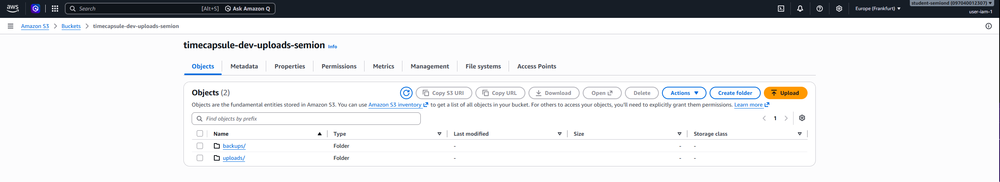
Бакет создан с `ACLs disabled`, `Block all public access` и шифрованием `SSE-S3`. В корне папки `uploads/` и `backups/`.

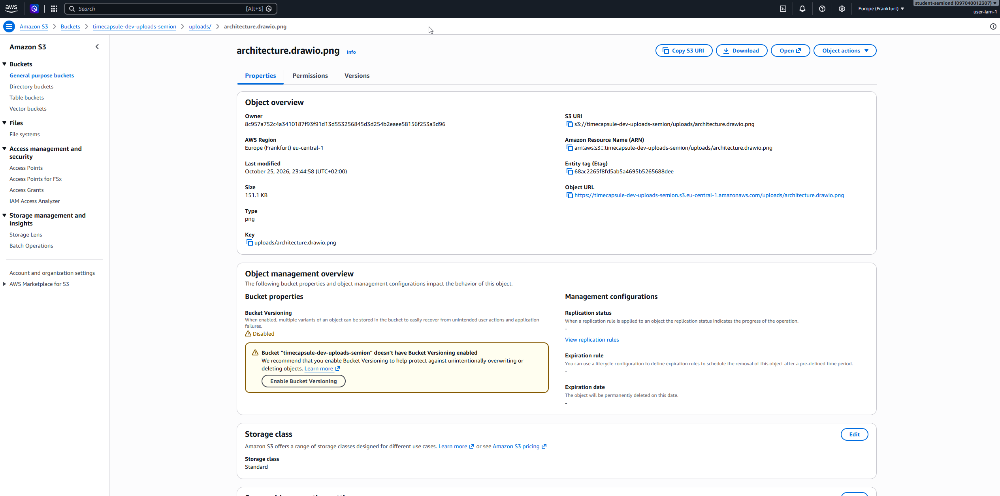
Свойства картинки: ключ `uploads/architecture.drawio.png`, тип `png`, `ETag` и `Object URL`. Полный `Content-Type` (`image/png`) виден в выводе `head-object` в задании 2.

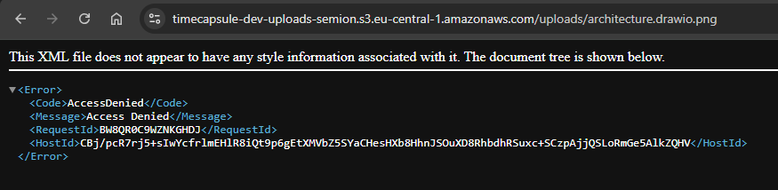
`Object URL` в браузере возвращает `AccessDenied`.

### Задание 2. Объекты из командной строки

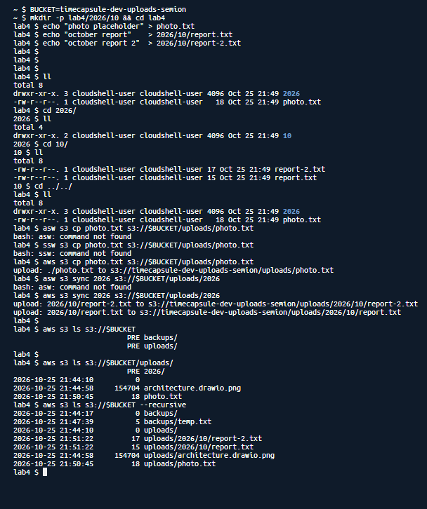
Три команды `aws s3 ls`: корень бакета, папка `uploads/` и все ключи с `--recursive`.

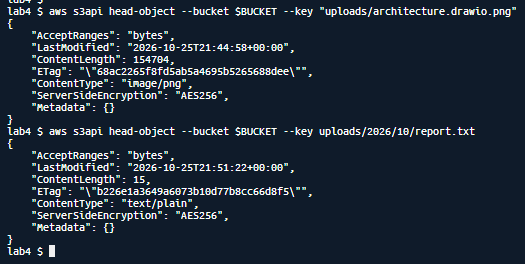
`head-object` показывает метаданные картинки и `report.txt` без скачивания.

### Задание 3. Политика бакета: только HTTPS

```json
{
  "Version": "2012-10-17",
  "Statement": [
    {
      "Sid": "DenyInsecureTransport",
      "Effect": "Deny",
      "Principal": "*",
      "Action": "s3:*",
      "Resource": [
        "arn:aws:s3:::timecapsule-dev-uploads-semion",
        "arn:aws:s3:::timecapsule-dev-uploads-semion/*"
      ],
      "Condition": {
        "Bool": { "aws:SecureTransport": "false" }
      }
    }
  ]
}
```

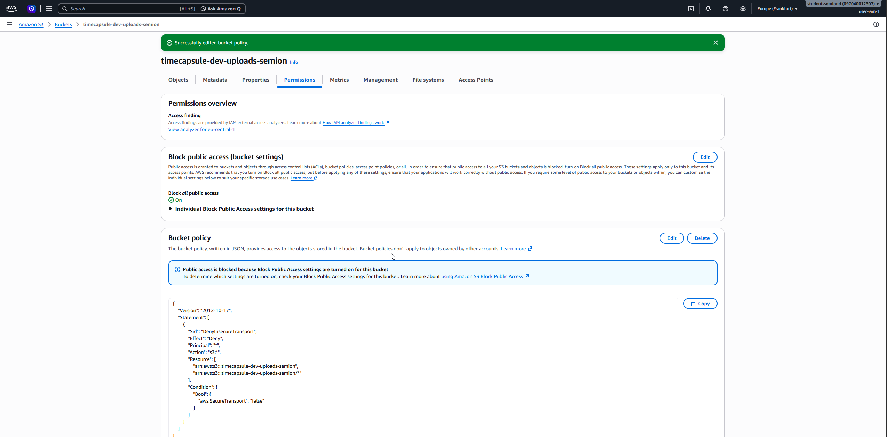
Политика сохранена на вкладке `Permissions`.

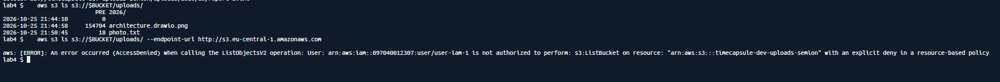
Запрос по HTTPS проходит, запрос по `http://` получает `AccessDenied`.

### Задание 4. Версионирование и защита от удаления

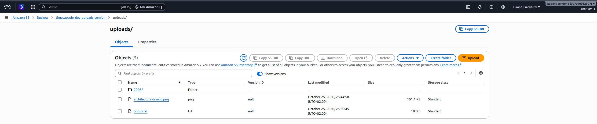
У файлов, загруженных до включения версионирования, `Version ID` равен `null`.

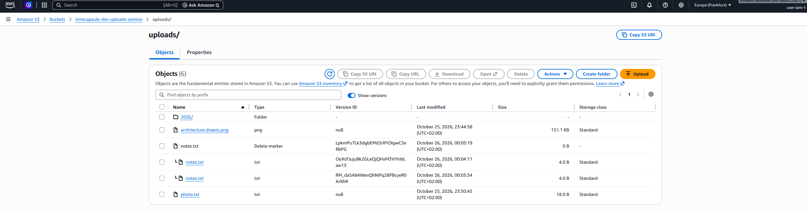
После удаления без `Show versions` у `notes.txt` появился `Delete marker`, обе версии на месте.

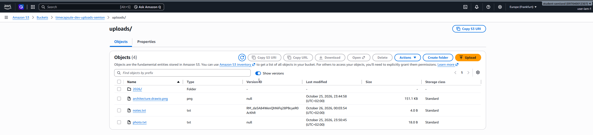
После удаления маркера и версии `v2` текущей стала `v1`.

### Задание 5. Правило жизненного цикла

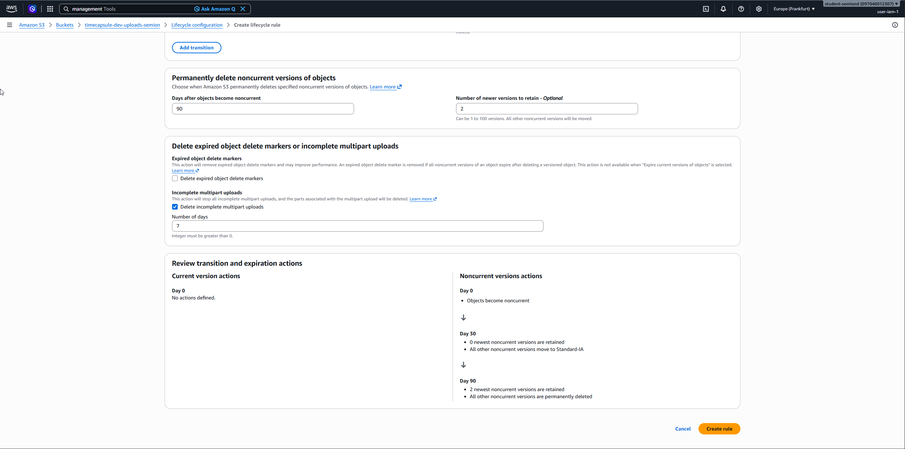
Правило `timecapsule-dev-noncurrent` для префикса `uploads/`: `Standard-IA` через 30 дней, удаление через 90 дней с сохранением двух новейших версий, незавершённые загрузки удаляются через 7 дней.

### Задание 6. Подписанные URL

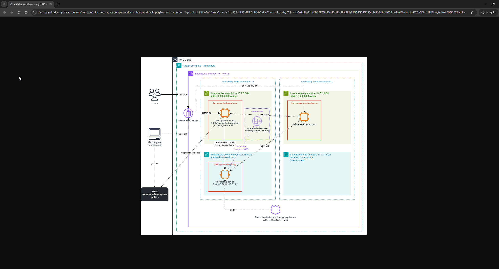
Ссылка из консоли открыла картинку в приватном окне.

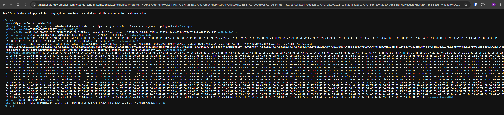
Ссылка с ключом `notes.txt` вместо `photo.txt`: `SignatureDoesNotMatch`.

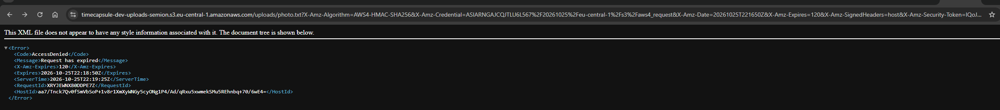
Та же ссылка через 2 минуты: `AccessDenied`, `Request has expired`.

## 2. Продвинутый уровень

### Задание 7. Политика приложения

```json
{
  "Version": "2012-10-17",
  "Statement": [
    {
      "Sid": "ListUploadsOnly",
      "Effect": "Allow",
      "Action": "s3:ListBucket",
      "Resource": "arn:aws:s3:::timecapsule-dev-uploads-semion",
      "Condition": {
        "StringLike": { "s3:prefix": ["uploads/*"] }
      }
    },
    {
      "Sid": "ReadWriteUploads",
      "Effect": "Allow",
      "Action": ["s3:GetObject", "s3:PutObject", "s3:DeleteObject"],
      "Resource": "arn:aws:s3:::timecapsule-dev-uploads-semion/uploads/*"
    }
  ]
}
```

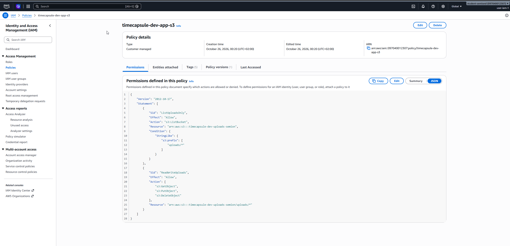
Политика `timecapsule-dev-app-s3` в IAM.

### Задание 8. Проверка прав через тестовую роль

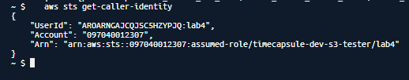
`aws sts get-caller-identity` от имени роли: `assumed-role/timecapsule-dev-s3-tester/lab4`.

| №   | Команда                                                                                    | Ожидаю         | Получил        | Какое правило сработало                                                  |
| --- | ------------------------------------------------------------------------------------------ | -------------- | -------------- | ------------------------------------------------------------------------ |
| 1   | `aws s3 cp test.txt s3://$BUCKET/uploads/test.txt`                                         | разрешено      | разрешено      | разрешение в политике приложения (`s3:PutObject` на `uploads/*`)         |
| 2   | `aws s3 ls s3://$BUCKET/uploads/`                                                          | разрешено      | разрешено      | разрешение в политике приложения (`s3:ListBucket`, префикс `uploads/`)   |
| 3   | `aws s3 ls s3://$BUCKET`                                                                   | `AccessDenied` | `AccessDenied` | неявный запрет: пустой префикс не подходит под `uploads/*`               |
| 4   | `aws s3 cp s3://$BUCKET/uploads/photo.txt -`                                               | разрешено      | разрешено      | разрешение в политике приложения (`s3:GetObject` на `uploads/*`)         |
| 5   | `aws s3 ls s3://$BUCKET/backups/`                                                          | `AccessDenied` | `AccessDenied` | неявный запрет: префикс `backups/`                                       |
| 6   | `aws s3 cp test.txt s3://$BUCKET/backups/test.txt`                                         | `AccessDenied` | `AccessDenied` | неявный запрет: `s3:PutObject` разрешён только на `uploads/*`            |
| 7   | `aws s3api list-object-versions --bucket $BUCKET --prefix uploads/`                        | `AccessDenied` | `AccessDenied` | неявный запрет: нужно `s3:ListBucketVersions`, его нет в политике        |
| 8   | `aws s3api delete-object --bucket $BUCKET --key uploads/test.txt --version-id <VersionId>` | `AccessDenied` | `AccessDenied` | неявный запрет: нужно `s3:DeleteObjectVersion`, его нет в политике       |
| 9   | `aws s3 rm s3://$BUCKET/uploads/test.txt`                                                  | разрешено      | разрешено      | разрешение в политике приложения (`s3:DeleteObject` на `uploads/*`)      |
| 10  | `aws s3 ls s3://$BUCKET/uploads/ --endpoint-url http://s3.eu-central-1.amazonaws.com`      | `AccessDenied` | `AccessDenied` | явный запрет в политике бакета (`aws:SecureTransport` = `false`)         |

Все ожидания совпали с результатом.

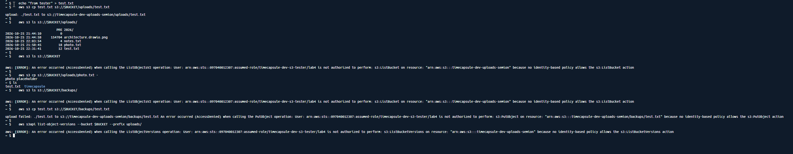
Команды 1-7.

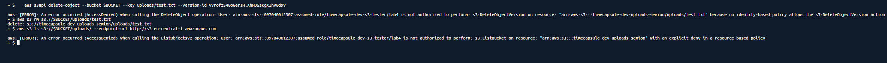
Команды 8-10.

### Задание 9. Роль сервера

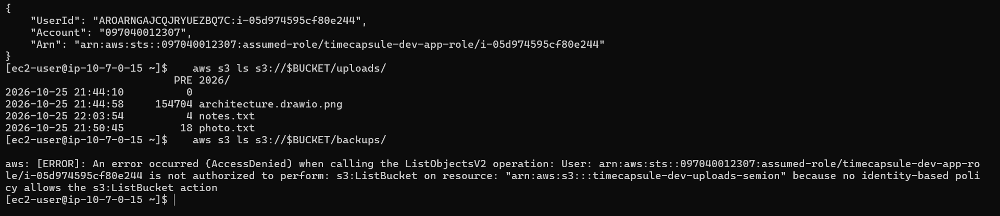
На `app-server` CLI работает от имени `timecapsule-dev-app-role`. Список `uploads/` доступен, список `backups/` получает `AccessDenied`.

### Задание 10. Перенос существующих файлов

Приложение на сервере лежит в `/var/www/timecapsule`, без папки `current`. Файлы принадлежат пользователю `apache`, поэтому `sync` запускается через `sudo`. Пустой файл `.gitkeep` из репозитория в бакет не нужен, поэтому `--exclude .gitkeep`.

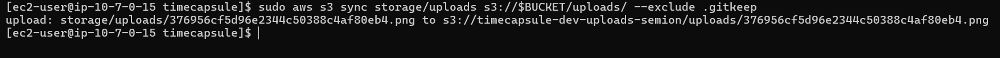
`aws s3 sync` загрузил в бакет единственное вложение из ЛР2.

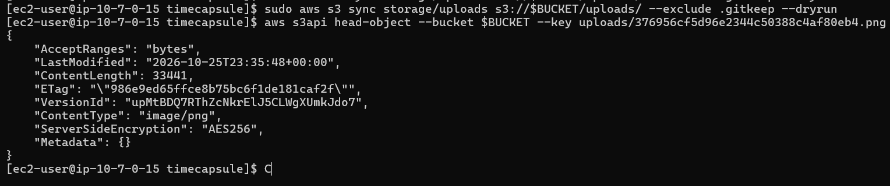
Повторный `--dryrun` ничего не выводит: все файлы уже в бакете. `ContentType` перенесённого объекта определён по расширению.

### Задание 11. Модуль хранения на S3

Изменения в репозитории:

- [src/storage.php](../../src/storage.php): `storage_save()` вызывает `putObject` с `SourceFile` и `ContentType`, `storage_delete()` вызывает `deleteObject`, `storage_stream()` отвечает кодом 302 на подписанный URL сроком 5 минут с `ResponseContentType` и `ResponseContentDisposition`.
- [views/layout.php](../../views/layout.php): подвал показывает `s3://<бакет>/uploads/` вместо `local disk`.
- [.env.example](../../.env.example): `S3_BUCKET` и `AWS_REGION` вместо `UPLOAD_DIR`. Ключей доступа нет.
- `composer.json`, `composer.lock`: добавлен `aws/aws-sdk-php`.

### Задание 12. Деплой и проверка

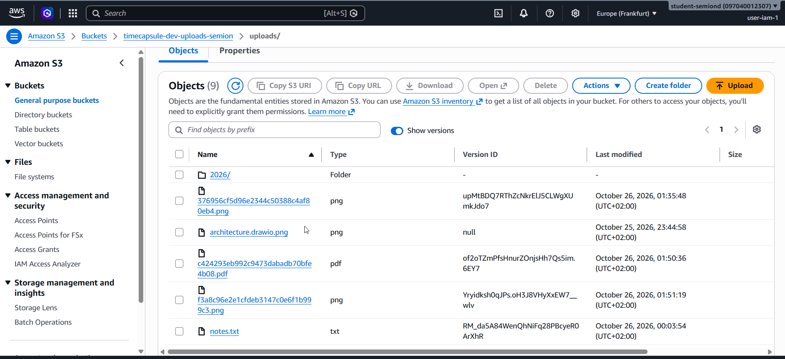
Новые объекты под `uploads/` со случайными именами: картинка `f3a8...9c3.png` и PDF `c424...4b08.pdf`.

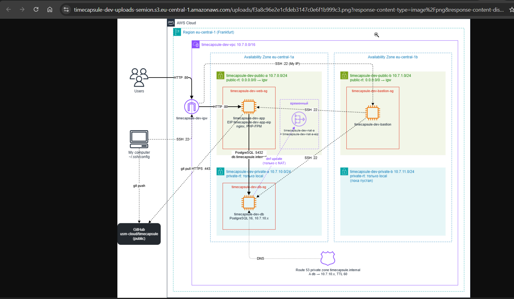
Картинка открыта по адресу `timecapsule-dev-uploads-semion.s3.eu-central-1.amazonaws.com/uploads/...` с параметрами `X-Amz-*`. Подпись закрыта.

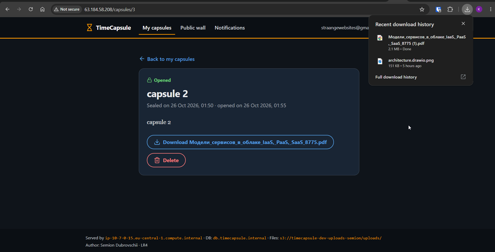
PDF сохранился под исходным именем.

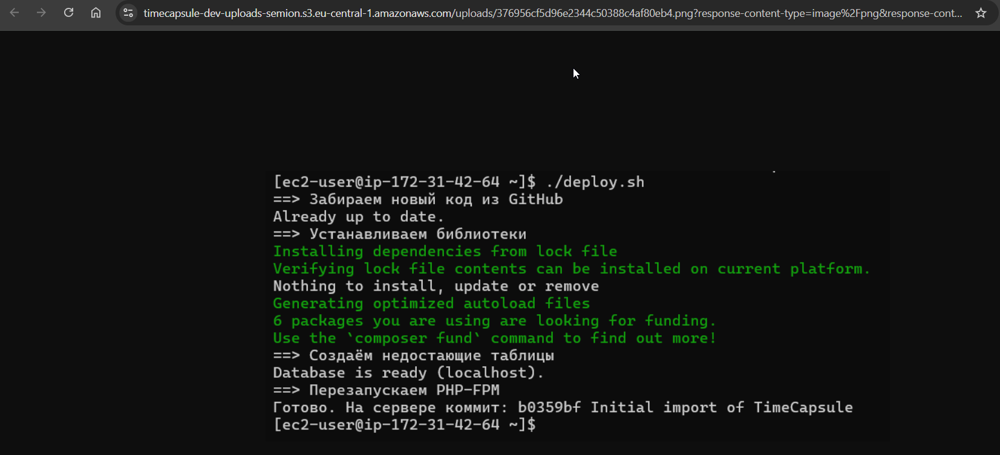
Вложение капсулы из ЛР2 (скриншот деплоя) тоже приходит из S3, по ключу `uploads/376956...eb4.png`, который перенёс `sync`.

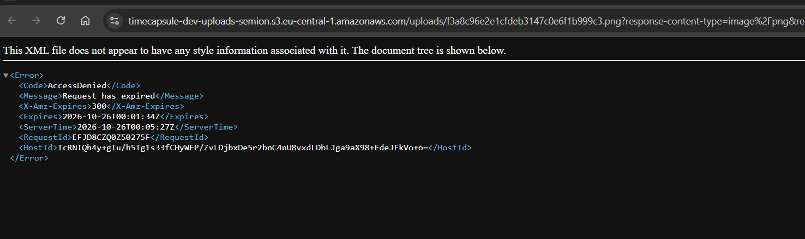
Через 5 минут та же ссылка возвращает `Request has expired`.

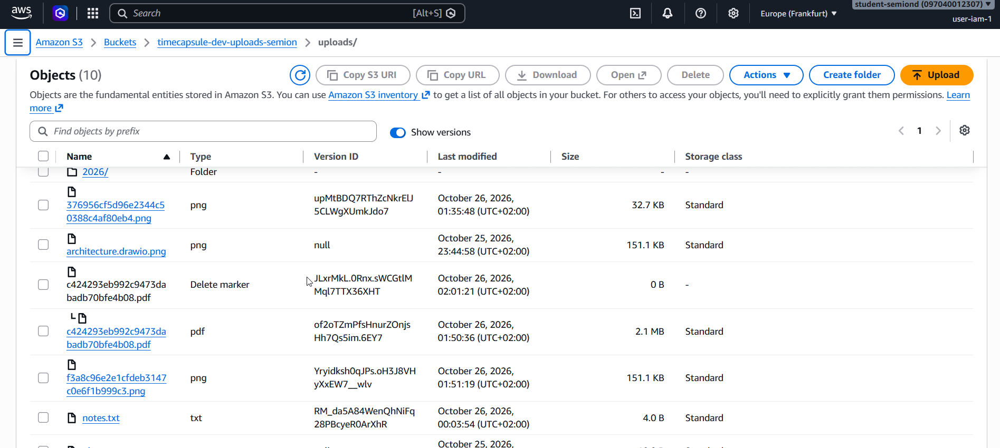
После удаления капсулы у её объекта `Delete marker` и прежняя версия.

### Задание 13. Сервер без состояния

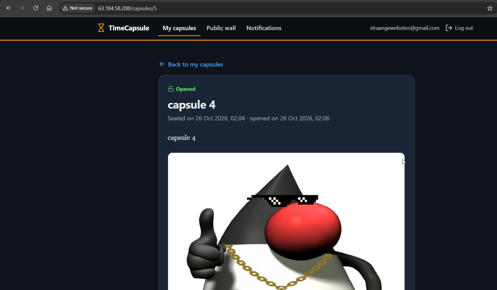
Папки `storage/uploads` на сервере больше нет. Старые и новые вложения открываются, новая капсула с картинкой создана.

Новая версия политики без `s3:ListBucket`:

```json
{
  "Version": "2012-10-17",
  "Statement": [
    {
      "Sid": "ReadWriteUploads",
      "Effect": "Allow",
      "Action": ["s3:GetObject", "s3:PutObject", "s3:DeleteObject"],
      "Resource": "arn:aws:s3:::timecapsule-dev-uploads-semion/uploads/*"
    }
  ]
}
```

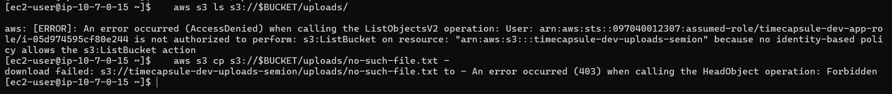
На сервере `ls` получает `AccessDenied`, а запрос несуществующего объекта получает `403 Forbidden`.

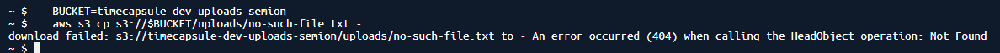
В CloudShell под моим пользователем тот же запрос получает `404 Not Found`.

## 3. Архитектура

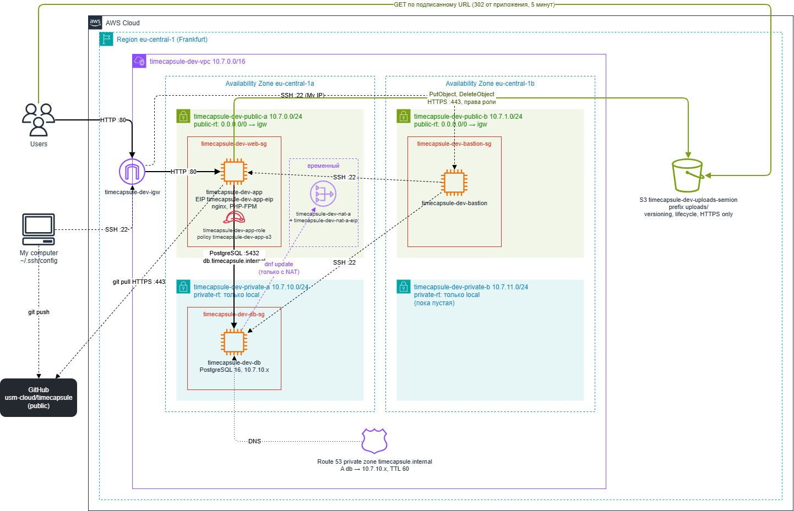

Сеть, bastion и `db-server` остались как в ЛР3.
Бакет `timecapsule-dev-uploads-semion` стоит в регионе, вне VPC. Вложения лежат под префиксом `uploads/`.
`app-server` получает права через роль `timecapsule-dev-app-role` и сам вызывает `PutObject` и `DeleteObject`.
Браузер скачивает вложение из S3 напрямую по подписанному URL, который выдал `app-server`.

Решение о хранении вложений: [ADR-0003](../adr/0003-attachment-storage.md).

## 4. Ответы на вопросы из заданий

**Задание 1. Какой ключ у картинки? Почему `Object URL` не открывается? Что создала кнопка `Create folder`?**
Ключ картинки `uploads/<имя файла>`, у меня `uploads/architecture.drawio.png`. Папок в S3 нет, есть только ключи со знаком `/`.
Браузер открывает `Object URL` без подписи, то есть как анонимный пользователь. Владелец бакета подтверждает себя подписью запроса, а браузер её не добавляет.
Бакет закрыт `Block all public access`, публичных разрешений нет, поэтому S3 отвечает `AccessDenied`.
`Create folder` создал пустой объект размером 0 байт с ключом `uploads/`. Консоль показывает такие объекты как папки.

**Задание 2. Почему первый `ls` показывает `PRE`, а третий полные ключи? Какой `Content-Type` получил `report.txt`?**
Без `--recursive` CLI запрашивает список с разделителем `/`. S3 сворачивает всё, что лежит после первого `/`, в общий префикс (`CommonPrefixes`), и CLI пишет его как `PRE uploads/`.
С `--recursive` разделителя нет, и S3 возвращает все ключи целиком.
`report.txt` получил `text/plain`. CLI сам угадывает тип по расширению файла и передаёт его в `PutObject`.

**Задание 3. Почему вторая команда получает `AccessDenied`, хотя у меня права администратора? Почему Block Public Access не помешал сохранить политику?**
Явный `Deny` сильнее любого `Allow`. AWS сначала ищет явные запреты во всех политиках, и запрет из политики бакета срабатывает раньше прав администратора.
Block Public Access запрещает политики, которые дают доступ всем (`Allow` с `"Principal": "*"`). Наша политика доступ только отнимает, бакет от неё публичным не становится.

**Задание 4. Чем удаление в шаге 3 отличается от удаления в шаге 5? Какое можно отменить? Какое запрещать приложению?**
В шаге 3 запрос шёл без идентификатора версии. S3 ничего не удалил, а добавил маркер удаления новой текущей версией. Старые версии остались, и удаление отменяется удалением маркера.
В шаге 5 удалялась конкретная версия. Она исчезает навсегда, поэтому консоль просит ввести `permanently delete`.
От случайного удаления защищает первый способ. Второй (`s3:DeleteObjectVersion`) нужно запрещать приложению.

**Задание 5. Как правило поведёт себя для файла, который перезаписали 10 раз за неделю? Почему маленькие файлы не попадут в Standard-IA? Что такое незавершённая загрузка частями?**
После 10 перезаписей у файла одна текущая версия и 10 неактуальных. Счёт дней у каждой версии идёт с момента, когда она стала неактуальной.
Через 30 дней после этого каждая неактуальная версия переходит в `Standard-IA`. Через 90 дней удаляются 8 старых версий, а 2 самые новые неактуальные остаются, пока не появятся ещё более новые.
С 2024 года S3 по умолчанию не переводит объекты меньше 128 КБ в другие классы. В `Standard-IA` за такой объект всё равно брали бы как за 128 КБ, и это дороже, чем хранить его в `Standard`.
Большой файл можно загружать частями (multipart upload): сначала части, потом команда `CompleteMultipartUpload`. Если загрузку прервали, части остаются в бакете. В списке объектов их не видно, но за их хранение платим.

**Задание 6. Какие ошибки вернул S3? Почему нельзя получить другой файл, поменяв ключ? Обращалась ли `presign` к S3?**
В шаге 3 S3 вернул `SignatureDoesNotMatch`, в шаге 4 `AccessDenied` с текстом `Request has expired`.
Подпись считается от всего запроса: метода, бакета, ключа, срока и параметров. Её считают секретным ключом, которого у пользователя нет. Если поменять ключ, подпись не совпадёт, а новую без секрета не посчитать.
Нет, `presign` к S3 не обращался. Он посчитал подпись на месте из моих учётных данных. Поэтому ссылку можно сделать даже на объект, которого нет.

**Задание 7. Почему `s3:ListBucket` относится к бакету, а `s3:GetObject` к объекту? Что будет, если перепутать ARN?**
Список объектов это операция над бакетом: запрос идёт к бакету, а не к какому-то объекту. Чтение работает с конкретным объектом, у которого свой ARN `бакет/ключ`.
Если перепутать, политика сохранится, но ни одно правило не подойдёт: `ListBucket` никогда не вызывается для ARN объекта, а `GetObject` для ARN бакета. Все запросы получат `AccessDenied` по неявному запрету.

**Задание 8. Чем политика доверия отличается от политики прав? Что стало с `test.txt` после команды 9? Сможет ли злоумышленник уничтожить файлы? А с `"s3:*"`?**
Политика доверия говорит, кто может взять роль: здесь любой IAM-пользователь моего аккаунта, у которого есть право `sts:AssumeRole`. Политика прав говорит, что роль может делать после этого.
После команды 9 S3 добавил к `test.txt` маркер удаления. Версия с текстом `from tester` осталась, и её можно вернуть, удалив маркер под моим пользователем.
С учётными данными приложения злоумышленник может удалять и перезаписывать файлы, но каждый раз появляется новая версия или маркер. Удалить версии он не может, поэтому всё можно восстановить. Срок для этого ограничен правилом жизненного цикла: через 90 дней старые неактуальные версии удаляются.
С `"s3:*"` он смог бы удалять версии (`s3:DeleteObjectVersion`), выключить версионирование и сменить правило жизненного цикла. Тогда файлы пропали бы навсегда.

**Задание 9. Где CLI на сервере взял учётные данные? Чем политика доверия отличается от тестовой? Почему это безопаснее ключа в `.env`?**
Роль привязана к серверу через профиль экземпляра (instance profile). CLI не нашёл ключей в переменных и файлах и спросил службу метаданных экземпляра (`169.254.169.254`). Она выдала временные ключи роли.
У тестовой роли в политике доверия мой аккаунт, у роли сервера служба `ec2.amazonaws.com`. Человек не может взять роль сервера через `assume-role`.
Временные ключи живут несколько часов и меняются сами. Их нет в файлах, в репозитории и в образе AMI. В ЛР3 пароль базы попал в образ вместе с `.env`, с ключом доступа было бы то же самое.

**Задание 10. Хватило ли прав для `aws s3 sync`? Какие действия использовала команда?**
Да. `sync` сначала получает список объектов в бакете под `uploads/` (`s3:ListBucket` с префиксом `uploads/`) и сравнивает его с файлами на диске.
Потом загружает недостающие файлы (`s3:PutObject`). Поэтому правило `s3:ListBucket` понадобилось именно здесь.

**Задание 12. Почему пересланную ссылку не нужно отзывать? Что осталось в бакете после удаления капсулы и когда это исчезнет?**
Ссылка сама перестаёт работать через 5 минут. Новую ссылку друг получить не может: приложение выдаёт её только владельцу открытой капсулы после входа.
В бакете остались маркер удаления и прежняя версия файла. Через 30 дней версия перешла бы в `Standard-IA`, если бы весила больше 128 КБ.
По нашему правилу она не удалится никогда: правило оставляет 2 самые новые неактуальные версии, а у этого файла она одна. Маркер тоже останется. Чтобы удалённые файлы исчезали, нужно второе правило: удалять неактуальные версии через 90 дней без сохранения двух новейших и удалять маркеры без версий (`Delete expired object delete markers`).

**Задание 13. Почему S3 ответил серверу и мне по-разному? Зачем? Что нужно, чтобы заменить `app-server`?**
Если у запрашивающего нет права `s3:ListBucket`, S3 на отсутствующий объект отвечает `403 Forbidden`, а не `404 Not Found`. У меня это право есть, и я получил `404`.
Так S3 не даёт узнать, какие ключи в бакете есть. Иначе можно было бы перебирать имена и по разнице ответов находить существующие файлы.
Чтобы заменить `app-server`: запустить новый экземпляр из образа или поставить код через `deploy.sh`, положить `.env`, привязать роль `timecapsule-dev-app-role` и перенести на него Elastic IP. Данные лежат в `db-server` и в S3, на сервере их нет.

## 5. Контрольные вопросы

**1. Как проходит запрос на скачивание вложения? Где проверяются права пользователя приложения, а где права роли?**
Браузер открывает `/capsules/<id>/file` на `app-server`. Приложение проверяет сессию, что пользователь может видеть капсулу и что она уже открыта. Это права пользователя приложения.
Потом приложение подписывает ссылку на `GetObject` временными ключами роли и отвечает кодом 302. Браузер идёт по ссылке прямо в S3.
S3 проверяет подпись и срок, затем права роли (`s3:GetObject` на `uploads/*`) и политику бакета (только HTTPS). Только после этого отдаёт файл.

**2. Какие настройки бакета и свойства подписанного URL не дают постороннему открыть вложение по прямому адресу?**
`Block all public access` и `ACLs disabled` не дают сделать объект публичным. Политик с `Allow` для всех нет, поэтому запрос без подписи получает `AccessDenied`.
Имя объекта случайное, 32 шестнадцатеричных знака, его не угадать. Подписанный URL работает только для одного ключа, 5 минут и только пока действуют ключи роли. Любое изменение ломает подпись.

**3. Почему приложение отдаёт файлы через подписанный URL, а не открывает бакет для чтения всем?**
Открытый бакет отдал бы файл любому, кто знает адрес, навсегда, и проверить права было бы негде. Вложения капсул личные.
С подписанным URL приложение решает, кому выдать ссылку, и ссылка быстро истекает. При этом файл всё равно идёт браузеру напрямую из S3, сервер его не передаёт.

**4. Как изменится схема, если вложения должны пережить отказ всего региона `eu-central-1`?**
Нужен второй бакет в другом регионе, например `eu-west-1`, и репликация (Cross-Region Replication). Для неё версионирование должно быть включено в обоих бакетах.
Приложение, база и сеть тоже должны существовать во втором регионе, иначе файлы есть, а работать с ними нечем. При отказе приложение переключают на второй бакет, а пользователей направляют во второй регион через Route 53.

## 6. Вывод

Я создал закрытый бакет S3 и научился работать с ним из консоли и CLI.
Я увидел, что версионирование превращает обычное удаление в маркер, а правило жизненного цикла ограничивает рост числа версий.
Политика бакета запрещает запросы без HTTPS даже администратору. Подписанный URL даёт доступ к одному объекту на короткий срок.
Я написал политику приложения с минимальными правами, проверил её через тестовую роль и выдал её серверу через роль EC2. Ключей доступа в `.env` нет.
Вложения TimeCapsule перенесены в S3. Браузер скачивает их по подписанному URL, а на `app-server` остались только код и настройки.

## 7. Источники

1. Задание лабораторной работы №4.
2. Amazon S3 User Guide: https://docs.aws.amazon.com/AmazonS3/latest/userguide/
3. Using versioning in S3 buckets: https://docs.aws.amazon.com/AmazonS3/latest/userguide/Versioning.html
4. Lifecycle configuration elements: https://docs.aws.amazon.com/AmazonS3/latest/userguide/intro-lifecycle-rules.html
5. Sharing objects with presigned URLs: https://docs.aws.amazon.com/AmazonS3/latest/userguide/ShareObjectPreSignedURL.html
6. IAM roles for Amazon EC2: https://docs.aws.amazon.com/AWSEC2/latest/UserGuide/iam-roles-for-amazon-ec2.html
7. Policy evaluation logic: https://docs.aws.amazon.com/IAM/latest/UserGuide/reference_policies_evaluation-logic.html
8. AWS SDK for PHP, presigned URLs: https://docs.aws.amazon.com/sdk-for-php/v3/developer-guide/s3-presigned-url.html
9. Amazon S3 pricing: https://aws.amazon.com/s3/pricing/
