# Лабораторная работа №5. Облачные базы данных. Amazon RDS

- **Студент:** Semion Dubrovschii
- **Группа:** I2402
- **Специальность:** Informatică
- **Уровень:** продвинутый
- **Репозиторий:** https://github.com/usm-cloud/timecapsule
- **Регион:** `eu-central-1` (Frankfurt), VPC `timecapsule-dev-vpc` (`10.7.0.0/16`)

Отчёты прошлых работ: ЛР2 в [README.md](../../README.md), ЛР3 в [docs/lab3/README.md](../lab3/README.md), ЛР4
в [docs/lab4/README.md](../lab4/README.md).

`web-server` из ЛР3 удалён, поэтому в Части 1 к базе подключается `app-server`. На него на время Части 1 повешена вторая
группа `lab5-web-sg`.

## 1. Базовый уровень

### Задание 1. Размещение и доступ к базе

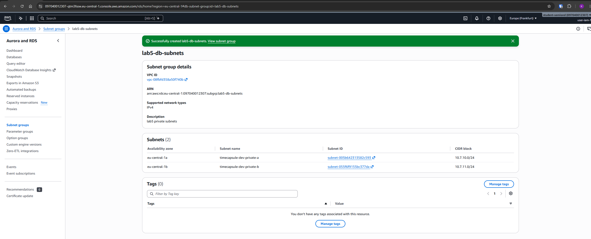
Группа подсетей `lab5-db-subnets`: `private-a` (`10.7.10.0/24`, `eu-central-1a`) и `private-b` (`10.7.11.0/24`,
`eu-central-1b`).

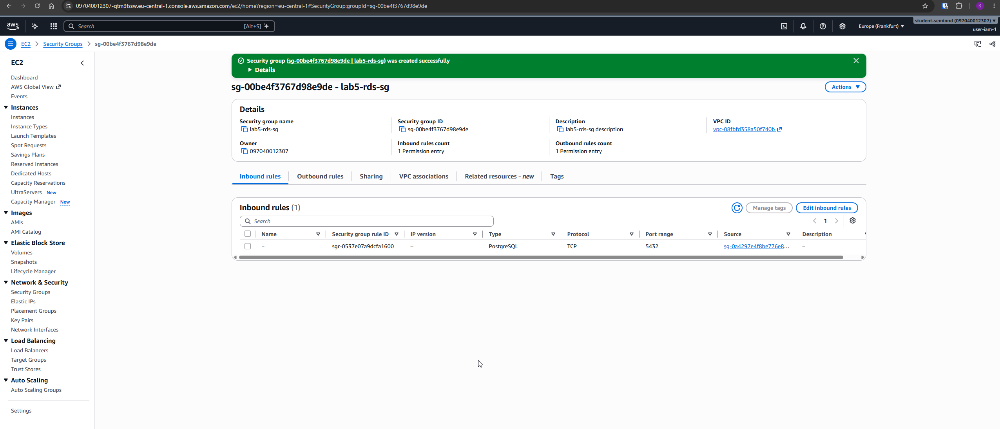
В `lab5-rds-sg` одно входящее правило: TCP 5432 от группы `lab5-web-sg`. У `lab5-web-sg` входящих правил нет, она только
помечает серверы, которым можно ходить в базу.

### Задание 2. База RDS

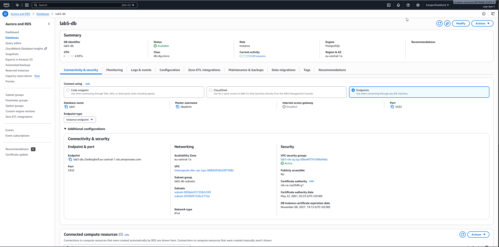
`lab5-db` в `eu-central-1a`, `Publicly accessible: No`, группа подсетей `lab5-db-subnets`, Security Group `lab5-rds-sg`.

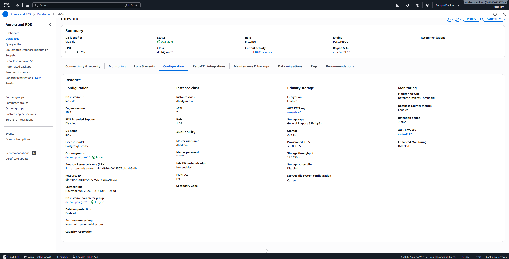
PostgreSQL 18.3, `db.t4g.micro`, gp3 20 ГиБ без автоувеличения, `Multi-AZ: No`, шифрование ключом `aws/rds` и защита от
удаления включены, резервные копии 7 дней.

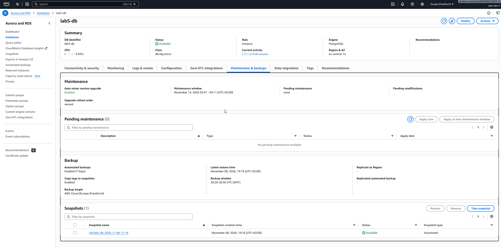
`Automated backups: Enabled (7 Days)`, `Latest restore time` и первый автоматический снимок сразу после создания базы.

### Задание 3. Подключение к базе

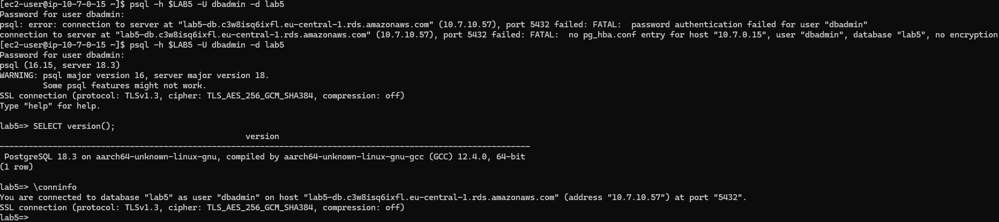
`SELECT version()` и `\conninfo`. Клиент `psql` 16.15, сервер 18.3, поэтому `psql` предупреждает о разнице версий.
Соединение зашифровано (`SSL connection`, TLSv1.3), хотя я не просил этого явно: `psql` сам пробует SSL. В первой
попытке я ошибся в пароле. После отказа по SSL `psql` попробовал подключиться без шифрования и получил
`no pg_hba.conf entry ... no encryption`. RDS не принимает незашифрованные соединения.

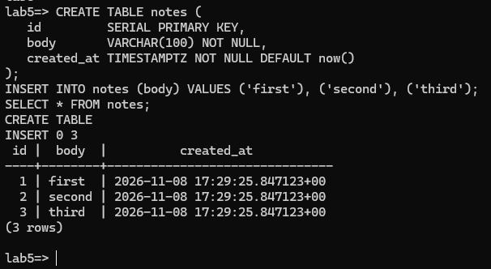
Таблица `notes` с тремя строками.

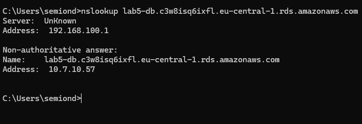
`nslookup` на моём компьютере (Windows) возвращает приватный адрес `10.7.10.57`. `dig` в WSL на скрине 08 даёт тот же
адрес, а `psql` на `app-server` подключается к нему же (скрин 05). Имя лежит в публичном DNS, но адрес из `10.7.10.0/24`
работает только внутри VPC.

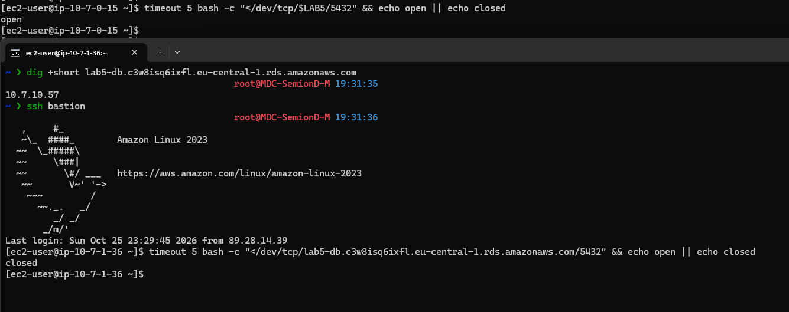
С `app-server` порт 5432 открыт, с `bastion` закрыт: у `bastion` нет группы `lab5-web-sg`. С моего компьютера
подключиться нельзя: имя даёт приватный адрес, а маршрута до него у меня нет.

### Задание 4. Реплика для чтения

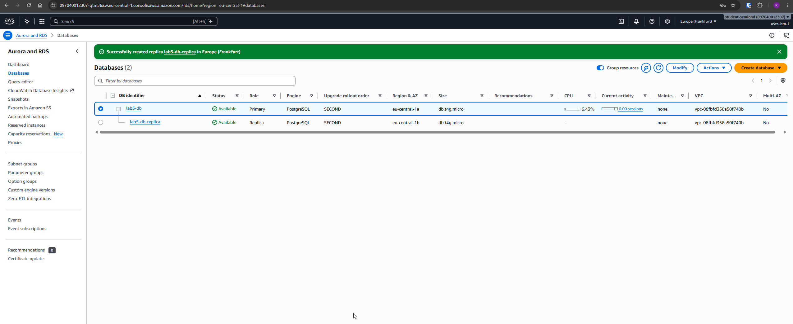
`lab5-db` с ролью `Primary` в `eu-central-1a` и `lab5-db-replica` с ролью `Replica` в `eu-central-1b`.

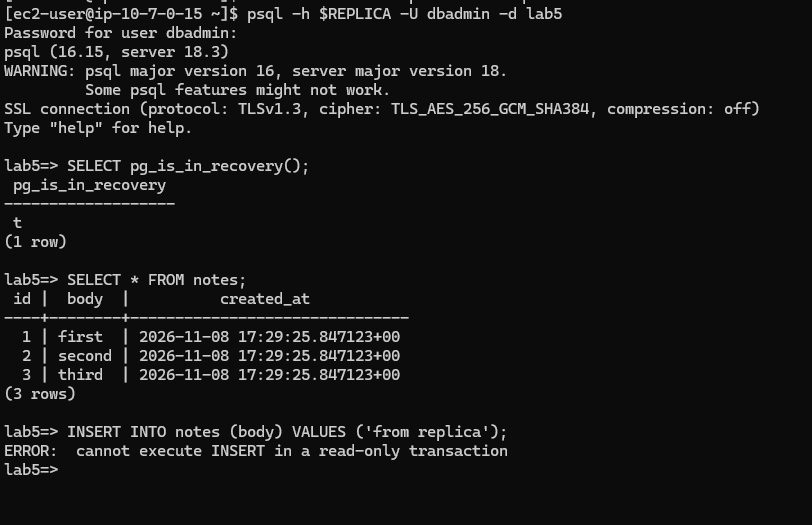
На реплике `pg_is_in_recovery()` возвращает `t`. Чтение работает, `INSERT` падает с ошибкой
`cannot execute INSERT in a read-only transaction`.

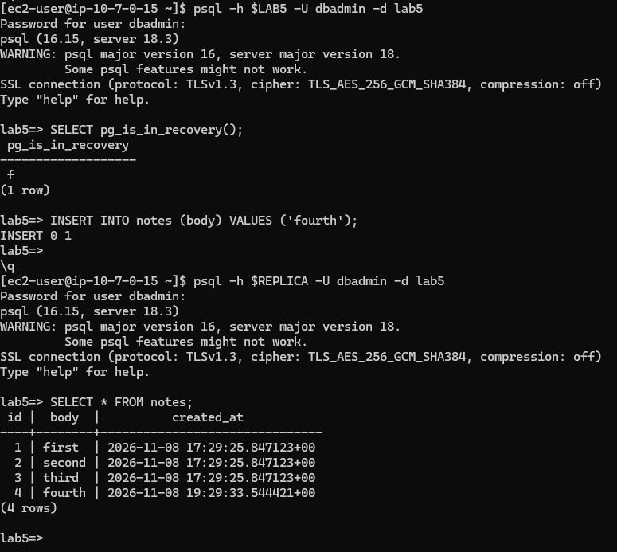
На основной базе `pg_is_in_recovery()` возвращает `f`. Строка `fourth`, добавленная на основной базе, видна на реплике.

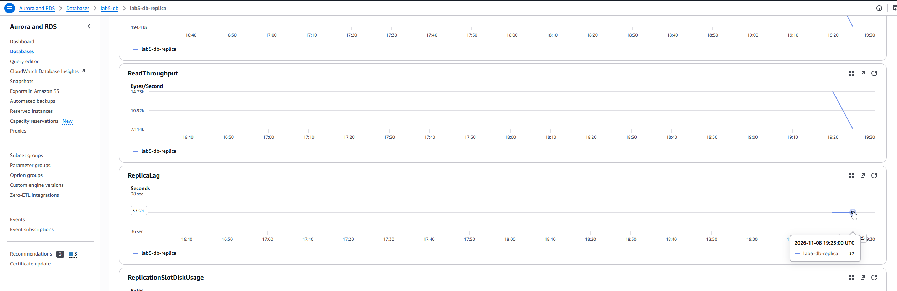
`ReplicaLag` у `lab5-db-replica`: 37 секунд в 19:25 UTC, сразу после создания реплики, пока она догоняла основную базу.
Строка `fourth` через несколько минут дошла до реплики сразу (скрин 11).

### Задание 5. Восстановление после ошибки

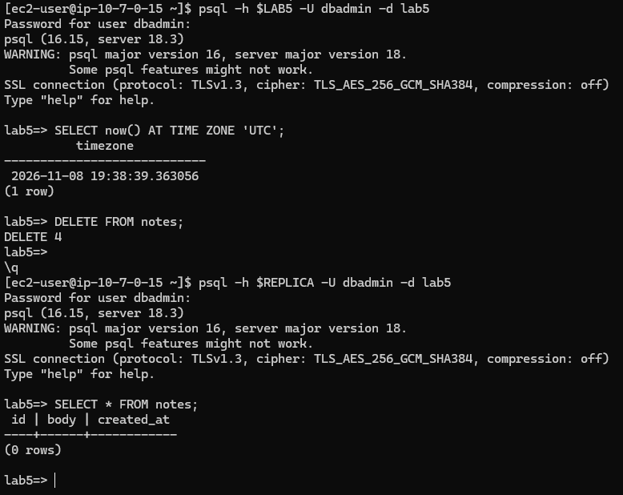
Время до ошибки 19:38:39 UTC. `DELETE FROM notes` удалил 4 строки, и на реплике таблица тоже пуста.

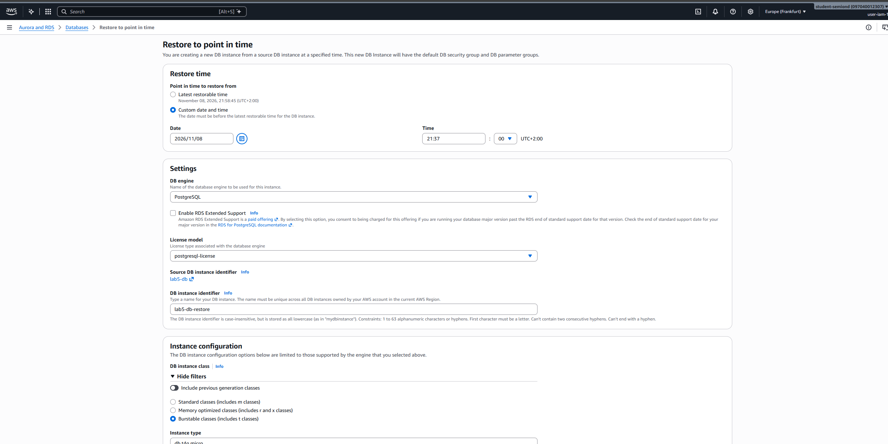
Восстановление в новую базу `lab5-db-restore`. Поле времени показывает пояс `UTC+2:00`, поэтому я указал 21:37:00, то
есть 19:37:00 UTC, на полторы минуты раньше удаления.

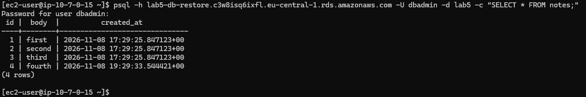
В копии все четыре строки: `first`, `second`, `third`, `fourth`.

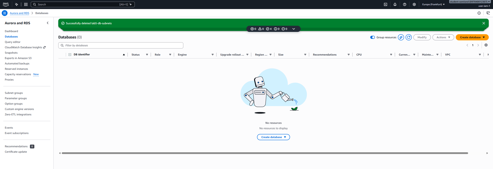
После Части 1 список баз пуст, группа подсетей `lab5-db-subnets` удалена. Группы `lab5-rds-sg` и `lab5-web-sg` тоже
удалены, `lab5-web-sg` перед этим снята с `app-server`.

## 2. Продвинутый уровень

### Задание 6. База приложения

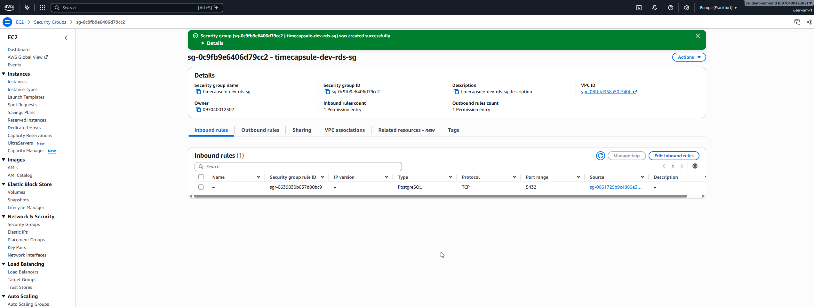
`timecapsule-dev-rds-sg` пускает TCP 5432 только от `timecapsule-dev-web-sg`. Эту группу носит `app-server`.

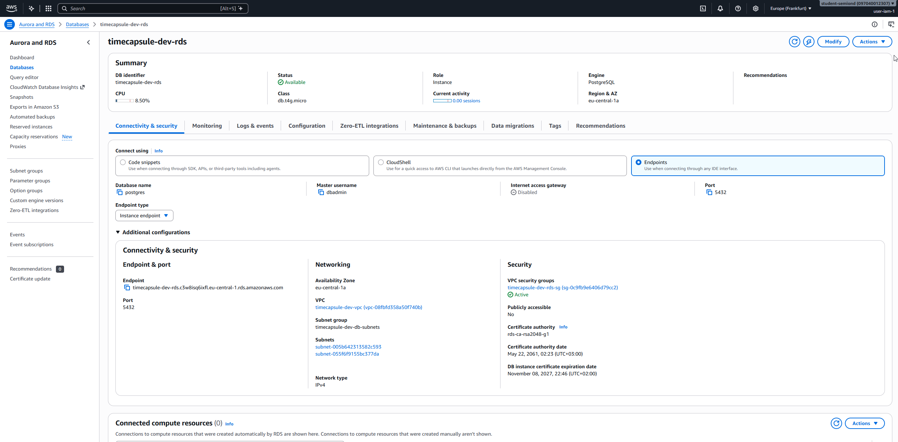
`timecapsule-dev-rds`: PostgreSQL 16, `eu-central-1a`, группа подсетей `timecapsule-dev-db-subnets` (`private-a`,
`private-b`), `Publicly accessible: No`.

Версия 16 выбрана по ветке `db-server` и клиента `pg_dump` на `app-server`. На скрине 24 `psql` 16.15 подключается без
предупреждения о разнице версий, как было с `lab5-db` 18.3.

### Задание 7. Ночная остановка базы

Политика расписания `timecapsule-dev-rds-stop` (номер аккаунта скрыт):

```json
{
  "Version": "2012-10-17",
  "Statement": [
    {
      "Sid": "StopAppDatabaseOnly",
      "Effect": "Allow",
      "Action": "rds:StopDBInstance",
      "Resource": "arn:aws:rds:eu-central-1:<ACCOUNT_ID>:db:timecapsule-dev-rds"
    }
  ]
}
```

Политика доверия роли `timecapsule-dev-scheduler-role`. Брать роль может только EventBridge Scheduler, и только для
расписаний моего аккаунта:

```json
{
  "Version": "2012-10-17",
  "Statement": [
    {
      "Sid": "SchedulerOnly",
      "Effect": "Allow",
      "Principal": {
        "Service": "scheduler.amazonaws.com"
      },
      "Action": "sts:AssumeRole",
      "Condition": {
        "StringEquals": {
          "aws:SourceAccount": "<ACCOUNT_ID>"
        }
      }
    }
  ]
}
```

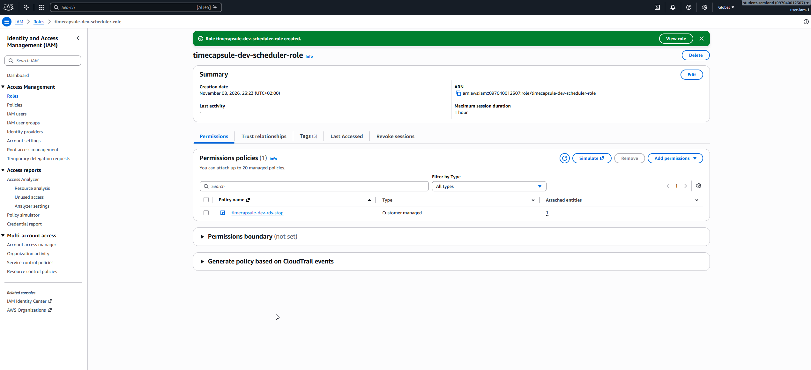
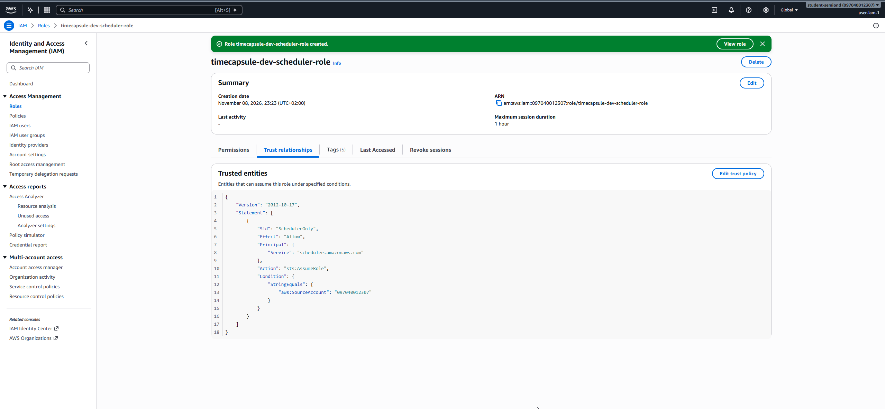


Расписание `timecapsule-dev-rds-nightly-stop` для проверки: cron `30 23 * * ? *`, то есть 23:30, `Europe/Chisinau`,
`Flexible time window` выключено. Цель `rds:StopDBInstance` с `{"DbInstanceIdentifier": "timecapsule-dev-rds"}`, роль
`timecapsule-dev-scheduler-role`.

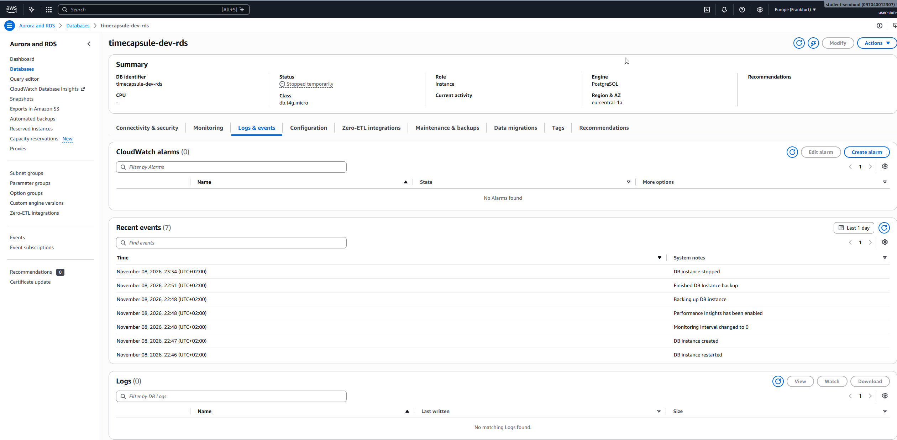
Расписание сработало в 23:30. База перешла в `Stopped temporarily`, в 23:34 в `Recent events` появилось событие
`DB instance stopped`. Сам вызов виден в CloudTrail (скрин 33).

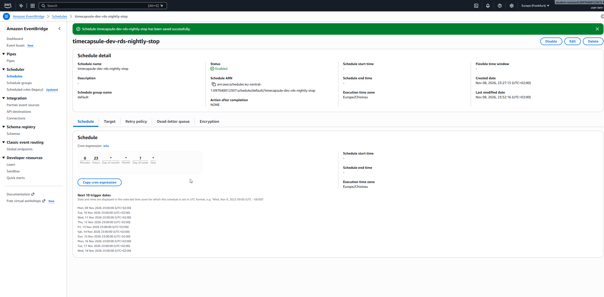
Рабочее выражение `0 23 * * ? *`: каждый день в 23:00 по Кишинёву.

### Задание 8. Пользователь и база данных

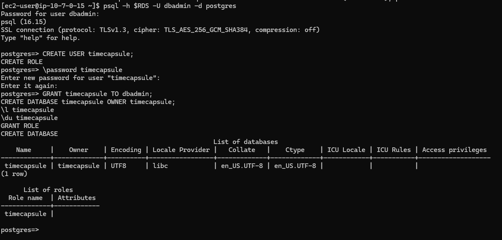
Пользователь `timecapsule` с паролем из `DB_PASSWORD`, база данных `timecapsule` с владельцем `timecapsule`.

### Задание 9. Перенос данных

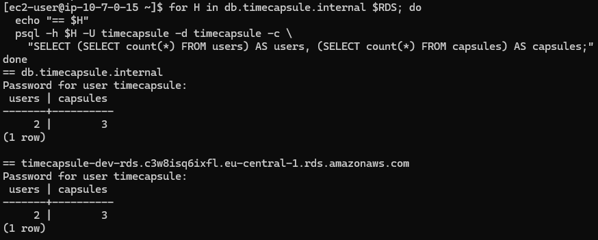

| База                                    | `users` | `capsules` |
|-----------------------------------------|---------|------------|
| `db-server` (`db.timecapsule.internal`) | 2       | 3          |
| `timecapsule-dev-rds`                   | 2       | 3          |

Файл `timecapsule.sql` удалён после загрузки: в нём хеши паролей пользователей.

### Задание 10. Переключение приложения

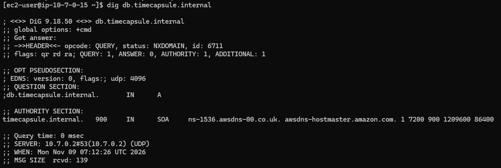
`db.timecapsule.internal` теперь запись `CNAME` на endpoint `timecapsule-dev-rds`, а тот разрешается в `10.7.10.x`.

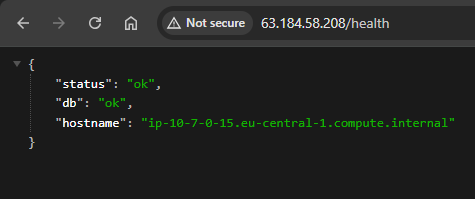
`/health` отвечает `"db":"ok"`. `.env` не менялся.

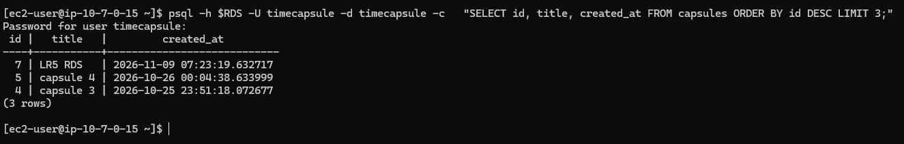
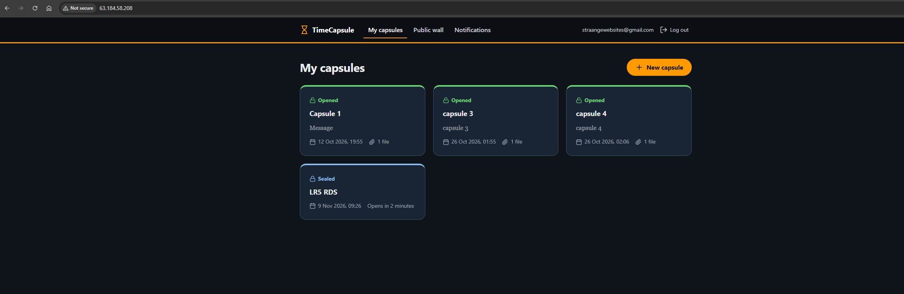
Новая капсула `LR5 RDS` (id 7) лежит в таблице `capsules` в RDS и видна в приложении рядом с капсулами, перенесёнными с
`db-server`.

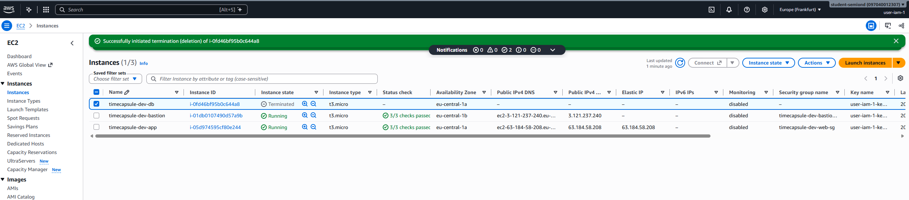
`timecapsule-dev-db` в состоянии `Terminated`, работают только `bastion` и `app-server`. Приложение работает без
`db-server`.

### Задание 11. Обслуживание базы

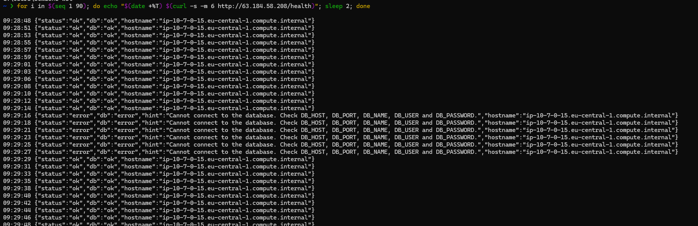
Во время перезагрузки `/health` с 09:29:16 до 09:29:27, около 12 секунд, отвечал `"db":"error"` с подсказкой
`Cannot connect to the database`. С 09:29:29 снова `"db":"ok"`.

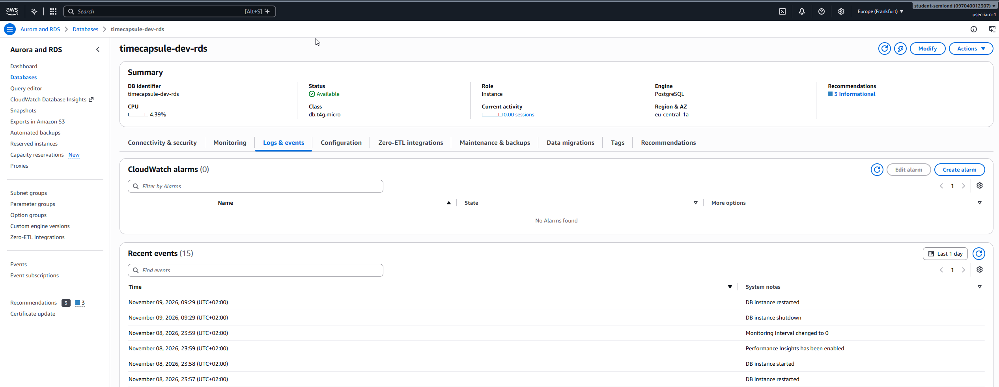
В 09:29 события `DB instance shutdown` и `DB instance restarted`. Ниже видны вечерние события: запуск базы после
проверки расписания.

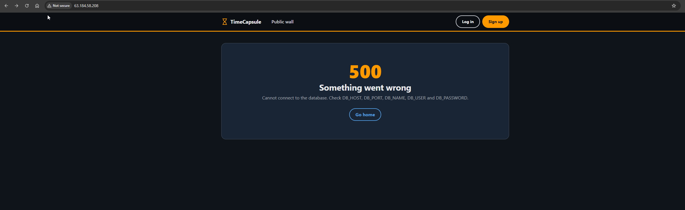
Пока база остановлена, приложение отвечает 500 с подсказкой `Cannot connect to the database`.

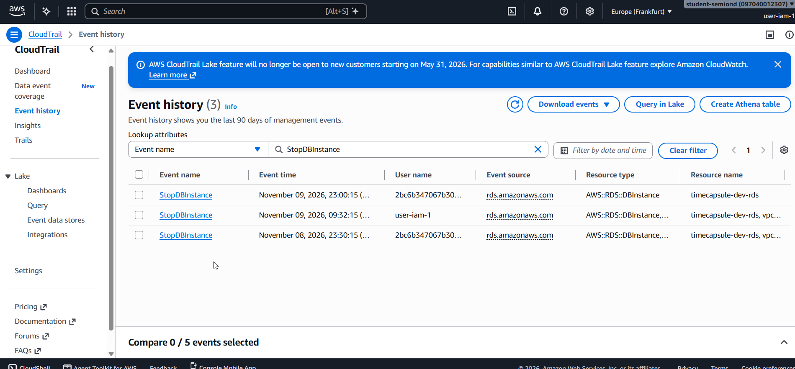
Три вызова `StopDBInstance`:

| Время (UTC+2)   | Кто вызвал                                        | Результат                     |
|-----------------|---------------------------------------------------|-------------------------------|
| 8 ноября, 23:30 | расписание, роль `timecapsule-dev-scheduler-role` | база остановлена (задание 7)  |
| 9 ноября, 09:32 | `user-iam-1`, вручную                             | база остановлена (задание 11) |
| 9 ноября, 23:00 | расписание, роль `timecapsule-dev-scheduler-role` | ошибка, база уже стояла       |

В колонке `User name` для расписания стоит не имя роли, а имя сессии роли. Его задаёт Scheduler, когда берёт роль.

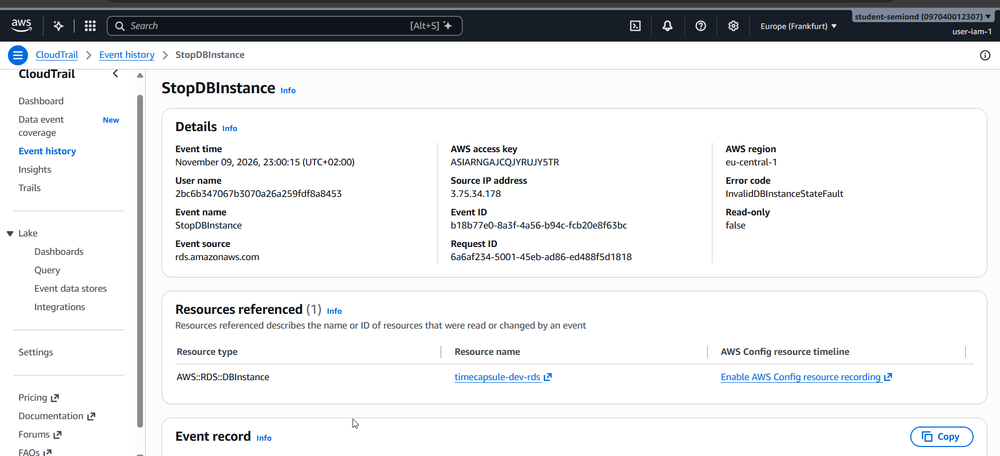
Вызов в 23:00 вернул `InvalidDBInstanceStateFault`: база не в состоянии `available`. Ключ `ASIA...` временный, его выдал
STS при взятии роли.

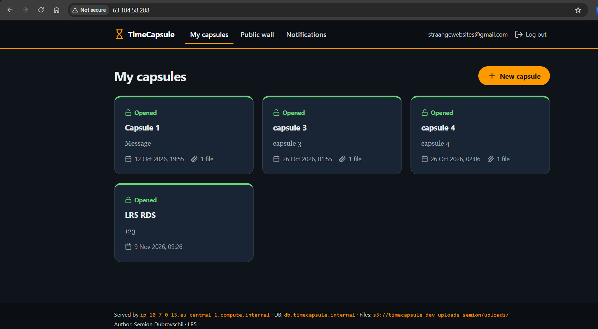
После запуска приложение работает без изменений в `.env` и в Route 53: endpoint тот же. В подвале
`DB: db.timecapsule.internal` и `LR5`.

## 3. Архитектура

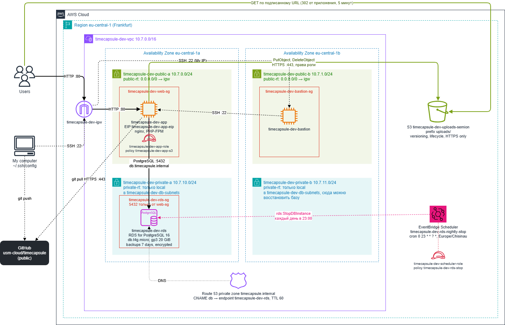

`db-server` удалён. База приложения `timecapsule-dev-rds` стоит в `private-a`, группа подсетей покрывает и `private-b`.
`app-server` находит её по имени `db.timecapsule.internal`: в приватной зоне Route 53 это `CNAME` на endpoint RDS.
Расписание EventBridge Scheduler каждый вечер останавливает базу от имени роли `timecapsule-dev-scheduler-role`.

Решение о размещении базы: [ADR-0004](../adr/0004-database-hosting.md).

## 4. Ответы на вопросы из заданий

**Задание 1. Почему удобнее указать Security Group источника, а не IP? Зачем две подсети?**
Правило с группой-источником пускает любой сервер, у которого есть эта группа. Новый или пересозданный сервер получает
доступ, как только ему назначат группу, и правило базы менять не нужно. Адрес сервера меняется при пересоздании. Правило
по IP пришлось бы править, а забытое правило пускало бы чужой сервер, получивший старый адрес. RDS требует, чтобы группа
подсетей покрывала минимум две зоны. Тогда RDS может создать реплику или резервный экземпляр Multi-AZ во второй зоне и
восстановить базу туда, если первая зона откажет.

**Задание 2. Как убедиться, что база принимает подключения только с нужного сервера? Почему `eu-central-1a`? От чего
защищает deletion protection?**
Проверить с разных мест: с `app-server` порт 5432 открыт, с `bastion` закрыт (скрин 08). Из интернета пути нет: у базы
нет публичного адреса, endpoint даёт приватный `10.7.10.x`.
`app-server` стоит в `public-a`, то есть в `eu-central-1a`. В одной зоне меньше задержка, и трафик между зонами не
оплачивается (около $0,01 за ГБ в каждую сторону). Deletion protection отклоняет удаление экземпляра из консоли, CLI и
API, пока её не выключат через `Modify`. Она не защищает от `DELETE`, `DROP TABLE` и других ошибок внутри базы, от
остановки и от отказа зоны.

**Задание 4. Почему `INSERT` на реплике не выполнился? Чем реплика отличается от резервного экземпляра Multi-AZ?**
Реплика всё время применяет журнал изменений (WAL) основной базы и находится в режиме восстановления
(`pg_is_in_recovery() = t`). PostgreSQL разрешает в этом режиме только чтение. Реплика получает изменения асинхронно, с
задержкой, у неё свой endpoint, и с неё можно читать. Её используют, чтобы снять нагрузку чтения. При отказе основной
базы её повышают до основной вручную, и endpoint меняется. Резервный экземпляр Multi-AZ получает изменения синхронно,
читать с него нельзя. При отказе RDS сам переключается на него за 1–2 минуты, endpoint остаётся тем же.

**Задание 5. Почему реплика не спасла данные? Почему восстановление создаёт новую базу?**
Реплика повторяет все изменения основной базы, в том числе ошибочный `DELETE`. Через секунды строки пропали и на ней.
Восстановление берёт последний снимок до выбранного момента и применяет к нему журнал изменений до этого момента. Это
делается на новом диске, поэтому получается новый экземпляр с новым endpoint. Старая база продолжает работать. В ней
могут быть нужные изменения, сделанные после ошибки. Из копии можно перенести только потерянные строки или переключить
приложение на копию.

**Задание 6. Какие параметры вы выбрали бы иначе для рабочей системы?**
Multi-AZ, чтобы пережить отказ зоны без ручного восстановления. Класс без ограничения по CPU-кредитам (например,
`db.m7g.large`) вместо `db.t4g.micro`. Автоувеличение хранилища с верхним пределом, чтобы база не встала из-за полного
диска. Срок резервных копий 14–35 дней и ручной снимок перед каждым изменением схемы. Пароль `dbadmin` в AWS Secrets
Manager с автоматической сменой, журналы PostgreSQL в CloudWatch Logs. Ночная остановка в рабочей системе не нужна:
пользователи работают и вечером.

**Задание 7. Зачем расписанию своя роль? Почему роль может остановить только одну базу?**
Расписание срабатывает, когда меня нет в консоли. Scheduler сам по себе прав в аккаунте не имеет, а мои учётные данные в
нём не хранятся. Он берёт роль и вызывает API с её временными ключами. В политике роли одно действие и ARN одной базы.
Если ошибиться в `DbInstanceIdentifier` или кто-то создаст другое расписание с этой ролью, другую базу оно не остановит
и ничего не удалит.

**Задание 8. Почему приложению нужен отдельный пользователь, а не `dbadmin`?**
`dbadmin` может создавать и удалять базы и пользователей и читать все базы экземпляра. Если украдут `.env` или найдут
SQL-инъекцию, злоумышленник получит все эти права. Пользователь `timecapsule` владеет только базой `timecapsule`. Кроме
того, пароль приложения можно сменить, не трогая пароль администратора.

**Задание 10. Почему не пришлось менять `DB_HOST`? Какие обязанности перешли к AWS?**
Приложение подключается по имени `db.timecapsule.internal`. Я поменял только запись в зоне: была `A` на `db-server`,
стала `CNAME` на endpoint RDS. Имя осталось прежним, поэтому `.env` не менялся. К AWS перешли: обновления ОС и минорные
обновления PostgreSQL в окно обслуживания, резервные копии и восстановление на момент времени, замена отказавшего
оборудования, шифрование диска, метрики. NAT Gateway для обновлений больше не нужен. За мной остались: схема и данные,
пользователи и пароли, Security Group и сеть, выбор параметров и мажорной версии, контроль расходов (остановка базы),
решение, когда и что восстанавливать.

**Задание 11. Что показывал `/health` при перезагрузке? Изменился ли endpoint? Какую ошибку получает расписание?**
Пока база перезагружалась, `/health` около 12 секунд отвечал `"status":"error","db":"error"` с подсказкой
`Cannot connect to the database`. Потом снова `"db":"ok"`, без действий с моей стороны: каждый запрос PHP открывает
новое соединение. Endpoint после остановки и запуска тот же, приложение заработало без изменений. Адрес за ним может
смениться, но имя RDS всегда указывает на текущий адрес экземпляра, поэтому приложение этого не замечает. Если база уже
остановлена, `StopDBInstance` возвращает `InvalidDBInstanceStateFault`: база не в состоянии `available`. База остаётся
остановленной, вреда от ошибки нет.

## 5. Контрольные вопросы

**1. Как проходит запрос от браузера до базы? Какие проверки он проходит?**
Браузер идёт на Elastic IP `app-server` через Internet Gateway. Network ACL `public-a` и `timecapsule-dev-web-sg`
пропускают HTTP (80). nginx передаёт запрос PHP-FPM, приложение проверяет сессию пользователя. PHP спрашивает DNS VPC
(`10.7.0.2`) имя `db.timecapsule.internal` и получает `CNAME` на endpoint, а потом адрес `10.7.10.x`. Пакет идёт по
маршруту `local` через Network ACL `private-a`, `timecapsule-dev-rds-sg` пускает 5432 только от`timecapsule-dev-web-sg`.
PostgreSQL принимает только соединения с SSL, проверяет пользователя и пароль и права на базу`timecapsule`.

**2. Чем репликация отличается от резервного копирования?**
Репликация копирует каждое изменение в другую работающую базу почти сразу. Она помогает пережить отказ сервера или зоны
и снять нагрузку чтения, но ошибку пользователя тоже копирует. Резервная копия хранит состояние базы в прошлом:
ежедневный снимок и журнал изменений за 7 дней. Она спасает от ошибок и порчи данных, но восстановление занимает минуты
и даёт новую базу.

**3. Как пережить отказ зоны `eu-central-1a` и сколько это стоит?**
Сейчас в `eu-central-1a` и база, и `app-server`, поэтому при отказе зоны не работает ничего. Резервные копии лежат в S3
региона и зону переживут: базу можно восстановить в `private-b` и переключить `CNAME`. Это ручная работа минут на 30,
потеря до 5 минут данных. Без ручной работы нужны RDS Multi-AZ (экземпляр и хранилище стоят вдвое больше,
около $14 в месяц сверху при работе круглосуточно), второй `app-server` в `public-b` (около $9) и Application Load
Balancer (около $20 в месяц).

**4. Как вы решили проблему автоматического запуска базы через 7 дней?**
Расписание `timecapsule-dev-rds-nightly-stop` каждый день в 23:00 вызывает `StopDBInstance`. Если AWS запустит базу
после 7 дней остановки, в тот же вечер расписание её остановит. Так база лишний раз работает меньше суток. Если база уже
стоит, вызов возвращает ошибку и ничего не меняет.

## 6. Вывод

Я создал базу RDS for PostgreSQL в приватной подсети. Подключиться к ней можно только с серверов с нужной Security Group
и только по SSL. Реплика для чтения получала изменения основной базы и не принимала запись. Ошибочный `DELETE` она
повторила за секунды, а восстановление на момент времени вернуло все строки в новую базу. База TimeCapsule переехала с
`db-server` в `timecapsule-dev-rds`. Приложение переключилось заменой записи в Route 53, без правки `.env`, и`db-server`
удалён. Резервные копии и обновления теперь делает AWS. Расходы ограничивает расписание, которое каждый вечер
останавливает базу от имени роли с одним правом.

## 7. Источники

1. Задание лабораторной работы №5.
2. Amazon RDS User Guide: https://docs.aws.amazon.com/AmazonRDS/latest/UserGuide/
3. Working with DB subnet
   groups: https://docs.aws.amazon.com/AmazonRDS/latest/UserGuide/USER_VPC.WorkingWithRDSInstanceinaVPC.html
4. Working with read replicas: https://docs.aws.amazon.com/AmazonRDS/latest/UserGuide/USER_ReadRepl.html
5. Restoring a DB instance to a specified time: https://docs.aws.amazon.com/AmazonRDS/latest/UserGuide/USER_PIT.html
6. Stopping an Amazon RDS DB instance
   temporarily: https://docs.aws.amazon.com/AmazonRDS/latest/UserGuide/USER_StopInstance.html
7. Using SSL with a PostgreSQL DB
   instance: https://docs.aws.amazon.com/AmazonRDS/latest/UserGuide/PostgreSQL.Concepts.General.SSL.html
8. EventBridge Scheduler, universal
   targets: https://docs.aws.amazon.com/scheduler/latest/UserGuide/managing-targets-universal.html
9. Amazon RDS for PostgreSQL pricing: https://aws.amazon.com/rds/postgresql/pricing/
